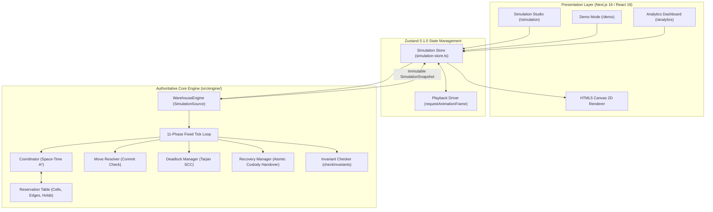

# SWARM — Warehouse Robot Coordination Arena

> **One warehouse. Multiple robots. Zero collisions.**

[](vitest.config.ts)
[](package.json)
[](package.json)
[](tsconfig.json)
[](https://github.com/Antrikshcodes/swarm-robotics-simulator/tree/feat/mission-001-frontend)
[](docs/README.md)

SWARM is an autonomous multi-robot warehouse coordination and simulation platform. It models a configurable warehouse grid, assigns prioritized pickup and drop-off missions, plans trajectories across space and time, prevents robot conflicts before movement occurs, and recovers autonomously from deadlocks, hardware breakdowns, and dynamic aisle closures without resetting the simulation.

---

## Project Status

- **Problem Benchmark:** NexHack 2.0 — Problem Statement 05
- **Working Branch:** `feat/mission-001-frontend` (Missions 001–005 implemented; Mission 006 analytics and demo mode active)
- **Repository:** [`Antrikshcodes/swarm-robotics-simulator`](https://github.com/Antrikshcodes/swarm-robotics-simulator)
- **Automated Test Suite:** 15 test files / 196 tests passing (Vitest)
- **Execution Mode:** Deterministic, in-browser discrete-tick engine (Zero remote dependencies)

---

## The Problem & The SWARM Solution

### The Multi-Robot Bottleneck
When dozens of Autonomous Mobile Robots (AMRs) operate in dense fulfillment centers, traditional decentralized navigation causes catastrophic failures:
1. **Narrow-Aisle Head-On Conflicts:** Robots meet in one-cell passages and freeze.
2. **Circular Deadlocks:** Multiple robots at cross-junctions wait on each other in closed dependency loops.
3. **Mid-Transit Hardware Breakdowns:** Broken carriers leave customer orders stranded and desynchronize inventory in the WMS.
4. **Dynamic Disruptions:** Pallet spills or lane repairs traditionally require restarting the entire simulation.

### The SWARM Architectural Solution
SWARM transforms uncoordinated fleets into a synchronized, deterministic logistics system:
- **4D Space-Time Reservations:** Robots lease physical cells `(x, y, t)` and directed edges `(u -> v, t)` across a 48-tick window, eliminating cell overlap and reverse edge swaps.
- **Graph-Theoretic Deadlock Resolution:** Constructs a wait-for dependency graph with 6-cell route lookahead, detects circular cycles via **Tarjan's SCC algorithm**, and directs the lowest-scoring yielder to back into a safe BFS holding bay.
- **Atomic Package Custody:** Decouples physical hardware breakdowns from inventory tracking. Custody remains locked to a broken carrier until an adjacent rescuer performs an atomic handover.
- **Zero-Downtime Dynamic Aisle Closures:** Closing an aisle invalidates intersecting routes and reroutes active robots in real time without pausing or resetting the engine.

---

## Complete Documentation Index

SWARM includes a comprehensive 32-document knowledge base and pitch strategy:

| Knowledge Category | Directory | Primary Documentation Files |
|---|---|---|
| **Strategy & Vision** | [`docs/strategy/`](docs/strategy/) | [PITCH_STRATEGY.md](docs/strategy/PITCH_STRATEGY.md) · [PROBLEM_STATEMENT.md](docs/strategy/PROBLEM_STATEMENT.md) · [SOLUTION_OVERVIEW.md](docs/strategy/SOLUTION_OVERVIEW.md) · [PRODUCT_VISION.md](docs/strategy/PRODUCT_VISION.md) · [VALUE_PROPOSITION.md](docs/strategy/VALUE_PROPOSITION.md) · [UNIQUE_SELLING_POINTS.md](docs/strategy/UNIQUE_SELLING_POINTS.md) · [COMPETITIVE_LANDSCAPE.md](docs/strategy/COMPETITIVE_LANDSCAPE.md) |
| **Business & Markets** | [`docs/business/`](docs/business/) | [TARGET_USERS.md](docs/business/TARGET_USERS.md) · [USER_PERSONAS.md](docs/business/USER_PERSONAS.md) · [USE_CASES.md](docs/business/USE_CASES.md) · [MARKET_OPPORTUNITY.md](docs/business/MARKET_OPPORTUNITY.md) · [BUSINESS_MODEL.md](docs/business/BUSINESS_MODEL.md) · [GO_TO_MARKET.md](docs/business/GO_TO_MARKET.md) |
| **Technical Specs** | [`docs/technical/`](docs/technical/) | [TECH_STACK.md](docs/technical/TECH_STACK.md) · [SYSTEM_ARCHITECTURE.md](docs/technical/SYSTEM_ARCHITECTURE.md) *(Diagrams A–E)* · [SIMULATION_ENGINE.md](docs/technical/SIMULATION_ENGINE.md) · [PATHFINDING_AND_COORDINATION.md](docs/technical/PATHFINDING_AND_COORDINATION.md) · [DEADLOCK_AND_RECOVERY.md](docs/technical/DEADLOCK_AND_RECOVERY.md) · [ROBOT_FAILURE_MANAGEMENT.md](docs/technical/ROBOT_FAILURE_MANAGEMENT.md) · [DATA_MODEL.md](docs/technical/DATA_MODEL.md) · [FRONTEND_ARCHITECTURE.md](docs/technical/FRONTEND_ARCHITECTURE.md) · [BACKEND_ARCHITECTURE.md](docs/technical/BACKEND_ARCHITECTURE.md) · [API_OVERVIEW.md](docs/technical/API_OVERVIEW.md) |
| **Product & Features** | [`docs/product/`](docs/product/) | [FEATURE_OVERVIEW.md](docs/product/FEATURE_OVERVIEW.md) · [USER_JOURNEYS.md](docs/product/USER_JOURNEYS.md) · [DEMO_SCENARIOS.md](docs/product/DEMO_SCENARIOS.md) · [PRODUCT_ROADMAP.md](docs/product/PRODUCT_ROADMAP.md) · [KNOWN_LIMITATIONS.md](docs/product/KNOWN_LIMITATIONS.md) |
| **Hackathon Defense** | [`docs/hackathon/`](docs/hackathon/) | [JUDGE_PITCH.md](docs/hackathon/JUDGE_PITCH.md) · [PITCH_SCRIPT.md](docs/hackathon/PITCH_SCRIPT.md) · [DEMO_SCRIPT.md](docs/hackathon/DEMO_SCRIPT.md) · [EXPECTED_JUDGE_QUESTIONS.md](docs/hackathon/EXPECTED_JUDGE_QUESTIONS.md) · [TECHNICAL_DEFENSE.md](docs/hackathon/TECHNICAL_DEFENSE.md) · [SUBMISSION_CHECKLIST.md](docs/hackathon/SUBMISSION_CHECKLIST.md) |
| **Master Hub** | [`docs/`](docs/) | [**docs/README.md**](docs/README.md) (Master Documentation Hub & Cross-Index) |

---

## Application Areas & Features

| Area | Route | Implemented Functionality |
|---|---|---|
| **Overview** | `/` | Fleet & mission KPIs, live warehouse canvas preview, active alert stream, quick scenario launchers |
| **Simulation Studio** | `/simulation` | Full HTML5 Canvas 2D arena (pan, zoom, fit, auto-follow); layer toggles (routes, reservations, wait graph); entity inspector; live fault injection (`fail_robot`, `restore_robot`, `close_aisle`, `reopen_aisle`, `add-mission`); seekable timeline |
| **Demo Mode** | `/demo` | Curated launcher for six deterministic evaluation scenarios with live metrics, incident feed, and automated completion state |
| **Fleet** | `/fleet` | Status-filtered roster (`idle`, `moving`, `carrying`, `waiting`, `failed`, `recovering`), battery telemetry, lifetime robot statistics |
| **Missions** | `/missions` | Priority-badged mission board, state-filtered log with custody audit trails, ad-hoc mission dispatch modal |
| **Incidents** | `/incidents` | Derived incident queue: deadlock cycles (`DL-nnnn`), machine failure records (`F-nn`), package rescue tasks (`RC-nn`), dynamic closures (`CL-nn`) |
| **Analytics** | `/analytics` | Time-windowed delivery throughput, fleet time allocation, movement-density heatmaps, recovery counters, per-robot comparisons |
| **Settings** | `/settings` | Configurable tick duration (50ms–1000ms), motion smoothing, visual layer preferences, keyboard shortcut reference |

---

## System Architecture



---

## Shipped Scenarios

1. **Standard Warehouse (`standard`):** 5 robots, seeded order feed with high and urgent missions; demonstrates steady-state throughput.
2. **Narrow Aisle (`narrow-aisle`):** Opposing missions compete for a single-cell passage; robots reserve it in turn or take an outer bypass.
3. **High-Density Stress (`high-density`):** 8 robots, heavy order feed; R-07 fails on dock at tick 40 to test station congestion handling.
4. **Deadlock Lab (Scenarios A–E):**
   - **A:** Two-robot head-on deadlock; one robot yields into a side pocket.
   - **B:** Three-robot circular wait at an intersection; cascading recovery.
   - **C:** Narrow aisle standoff against a convoy; passage priority & convoy rules.
   - **D:** High-traffic doorway; verifies zero false-positive deadlock declarations.
   - **E:** Sealed corridor with no safe holding bay; safe failure handling.
5. **Recovery Lab (Scenarios A–F):**
   - **A:** Carrier fails before pickup; mission requeued and reassigned.
   - **B:** Carrier fails carrying cargo; rescuer performs atomic handover.
   - **C:** Aisle closes under moving routes; live route invalidation and detour.
   - **D:** Closure over occupied cell; robot exits safely.
   - **E:** Dock cut off mid-transit; reopening restores delivery.
   - **F:** Rescuer robot fails en route; custody preserved; second rescuer dispatched.

---

## Local Development & Setup

### Prerequisites
- **Node.js:** Version 20.9+ (Tested on Node 22 and Node 24)
- **Package Manager:** `npm` 10+

### Installation & Execution
```bash
# Clone the repository
git clone https://github.com/Antrikshcodes/swarm-robotics-simulator.git
cd swarm-robotics-simulator

# Checkout the working feature branch
git checkout feat/mission-001-frontend

# Install dependencies
npm ci

# Start local development server (Turbopack)
npm run dev
```

Open [http://localhost:3000](http://localhost:3000) in your browser.

### Verification Scripts
```bash
# Run strict type checking
npm run typecheck

# Run code linter
npm run lint

# Run automated Vitest test suite (15 files / 196 tests)
npm test

# Run multi-robot scaling benchmark (4–32 robots)
npm run bench

# Run full CI quality check (lint + typecheck + test)
npm run check
```

---

## Measured Performance & Scaling

Measured on Apple Silicon (M5, Node 24) across 600 ticks on a synthetic $40 \times 27$ grid:

| Fleet Size | ms / Tick (Mean) | ms / Tick (p95) | Plans / Tick | Nodes / Plan | Deliveries | Waiting Share | Commit Rejections |
|---|---|---|---|---|---|---|---|
| **4 Robots** | 0.15 ms | 0.49 ms | 0.18 | 1,008 | 23 | 0.3% | **0** |
| **8 Robots** | 0.25 ms | 2.28 ms | 0.41 | 794 | 45 | 0.5% | **0** |
| **16 Robots** | 0.57 ms | 2.86 ms | 1.14 | 679 | 86 | 1.3% | **0** |
| **24 Robots** | 0.81 ms | 3.15 ms | 1.79 | 595 | 125 | 1.7% | **0** |
| **32 Robots** | 1.17 ms | 3.44 ms | 2.69 | 597 | 162 | 2.3% | **0** |

*Cost scales linearly with active fleet size because only agents requiring new paths are replanned (~0.08 plans/robot/tick).*

---

## Repository Structure

```text
swarm-robotics-simulator/
├── docs/                     # Complete SWARM Knowledge Base (32 Documents)
│   ├── strategy/             # Pitch, Problem, Solution, Vision, USPs, Competitors
│   ├── business/             # Target Users, Personas, Use Cases, Market Sizing, GTM
│   ├── technical/            # Architecture, Engine, Coordination, Deadlocks, Custody
│   ├── product/              # Features, Journeys, Demo Scenarios, Roadmap, Limits
│   ├── hackathon/            # Pitch Script, Demo Script, 28 Q&A, Technical Defense
│   └── README.md             # Master Documentation Hub & Navigation
├── presentations/            # Hackathon pitch deck (PDF, PPTX) and slide specs
├── src/
│   ├── app/                  # Next.js App Router routes (/, /simulation, /demo, etc.)
│   ├── components/           # UI, layout, simulation, and dashboard components
│   ├── engine/               # Pure TypeScript deterministic simulation engine
│   │   ├── coordination/     # Space-Time A*, ReservationTable, MoveResolver
│   │   ├── deadlock/         # Wait-for graph, Tarjan SCC, DeadlockManager
│   │   ├── recovery/         # Robot failure recovery & rescuer dispatch
│   │   ├── custody/          # Atomic package custody finite state machine
│   │   ├── missions/         # Mission lifecycle state machine
│   │   ├── robots/           # Robot lifecycle and status transitions
│   │   ├── pathfinding/      # Spatial A* & binary min-heap
│   │   ├── world/            # ASCII warehouse layout parser & geometry
│   │   ├── core/             # Mulberry32 PRNG & Result error types
│   │   ├── scenarios/        # Shipped operational and lab scenario definitions
│   │   └── warehouse-engine.ts # Authoritative engine & discrete-tick loop
│   ├── lib/                  # Canvas renderer, formatters, and analytics
│   ├── store/                # Zustand stores (simulation, preferences, viewport)
│   └── types/                # Core TypeScript definitions (SimulationSnapshot)
└── vitest.config.ts          # Test suite configuration (15 test files / 196 tests)
```

---

## Contributing & Branching Workflow

1. All feature work is developed on dedicated mission branches (e.g., `feat/mission-001-frontend`).
2. Algorithmic simulation logic must remain in `src/engine/`, strictly decoupled from presentation.
3. Every new feature must include automated Vitest tests covering safety invariants and determinism.
4. `npm run check` (lint, typecheck, tests) must pass with zero warnings or errors prior to committing.
5. Direct commits to `main` are strictly prohibited; changes require review before merging.

---

## License

This project is licensed under the MIT License.
