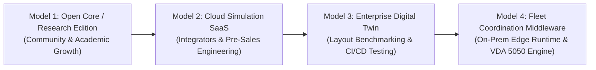

# SWARM — Proposed Business Model & Commercialization Strategy

> **Status:** IMPLEMENTED (Proposed Business Strategy)  
> **Last Verified:** 2026-11-24  
> **Classification:** Proposed Commercial Strategy (No Active Revenue Streams at Current Hackathon Prototype Phase)

---

## 1. Product Model Options & Strategic Fit

SWARM evaluates five potential commercialization models, transitioning from developer adoption to high-value enterprise deployment:



1. **SaaS Fleet Simulation & Benchmarking Platform (Short-Term Focus):** Browser-accessible layout simulator for automation integrators and facility planners to evaluate warehouse rack configurations, fleet sizing, and congestion before buying hardware.
2. **Robotics CI/CD Testing Environment:** Headless simulation test harness integrated into robotics firmware repositories to automatically catch deadlocks, edge swaps, and custody bugs prior to production code releases.
3. **Enterprise Edge Coordination Middleware (Long-Term Focus):** On-premise industrial server software deployed in warehouse data closets that dispatches live trajectories to physical AMRs via VDA 5050 MQTT protocols.
4. **Educational & Academic Lab Licensing:** Free open-core version for universities with low-cost multi-seat cloud lab management for university robotics courses.
5. **Custom Engineering & Systems Integration:** High-margin professional services for bespoke WMS/WES integrations and custom warehouse topology optimization.

---

## 2. Proposed Pricing & Monetization Tiers

> [!NOTE]
> All pricing tiers below represent proposed commercial packaging designed to capture value across the customer lifecycle; they do not reflect active billing accounts.

| Tier | Target Customer | Packaging & Capabilities | Proposed Pricing Model |
|---|---|---|---|
| **Community / Academic** | Students, university labs, independent researchers | Browser-based Simulation Studio, standard ASCII warehouse layouts, up to 8 robots, local browser storage | **Free & Open-Source** (Apache 2.0 / MIT) |
| **Professional (SaaS)** | Independent logistics consultants, boutique integrators | Custom CAD / ASCII layout editor, up to 32 robots, cloud scenario archiving, PDF export of congestion reports & throughput KPIs | **\$499 / user / month** (Annual commitment) |
| **Team / Enterprise Sim** | Tier-1 systems integrators (Bastian, Fortna, Swisslog), AMR OEMs | Unlimited robots, headless CLI for CI/CD regression testing, multi-user workspace, priority ticket support | **\$2,500 / team / month** (Includes 5 seats) |
| **Enterprise Edge Runtime** | E-commerce fulfillment hubs, 3PL distribution centers | On-premise Docker/Kubernetes deployment, high-availability clustering, VDA 5050 AMR driver, SAP/Manhattan WMS bridge | **\$35,000 – \$75,000 / facility / year** + deployment services |

---

## 3. Unit Economics & Cost Structure (Proposed SaaS Model)

### Revenue Metrics (Projected Unit Economics)
- **Average Revenue Per Account (ARPA):** \$15,000 / year (blended across Pro and Enterprise Sim tiers).
- **Customer Acquisition Cost (CAC):** \$4,500 (driven by developer-led open-source inbound marketing and logistics conference presence).
- **Target LTV / CAC Ratio:** $\approx 4.5\times$ over a 3-year enterprise horizon.
- **Gross Margin Target:** $80–85\%$ (software-only delivery).

### Cost Drivers
1. **Cloud Compute & Telemetry Infrastructure:** Low per-user cost due to client-side WebAssembly / TypeScript execution in browser; cloud costs limited to scenario persistence and headless batch regression runs (AWS ECS / Supabase).
2. **Software Engineering & Algorithm R&D:** Core development team focused on MAPF heuristics, VDA 5050 protocol support, and high-performance graph algorithms.
3. **Enterprise Sales & Solutions Architecture:** Technical pre-sales engineers who assist integrators in modeling complex customer facilities.

---

## 4. Key Decision-Makers & Buyer Personas

Enterprise software in warehouse logistics requires multi-stakeholder consensus. SWARM identifies the following buying committee:

```
┌────────────────────────────────────────────────────────────────────────┐
│                        BUYING COMMITTEE PROFILE                        │
│                                                                        │
│   Economic Buyer: VP of Engineering / VP of Global Fulfillment         │
│   ├── Signs purchase orders; cares about overall throughput, labor     │
│   │   cost reduction, and meeting shipping SLAs.                       │
│   │                                                                    │
│   Technical Champion: Principal Systems Architect / Lead Integrator    │
│   ├── Uses the software directly; cares about ease of use, simulation  │
│   │   accuracy, CAD importing, and eliminating edge cases.             │
│   │                                                                    │
│   Gatekeeper: Director of IT & Operational Technology (OT)             │
│   └── Evaluates on-premise security, Docker deployment, latency,       │
│       and compatibility with industrial network firewalls.             │
└────────────────────────────────────────────────────────────────────────┘
```
