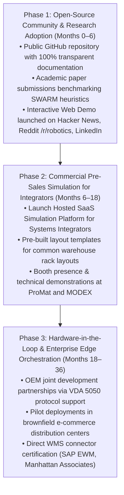

# SWARM — Go-To-Market (GTM) Strategy

> **Status:** IMPLEMENTED (GTM Strategy)  
> **Last Verified:** 2026-11-24  
> **Framework:** Phased Developer-Led Inbound & Direct Enterprise Expansion

---

## 1. Phased GTM Roadmap

SWARM executes a bottom-up, developer-first Go-To-Market strategy that transitions into enterprise sales:



---

## 2. Customer Acquisition Channels

### Channel 1: Developer-Led & Open-Source Community Inbound
- **GitHub Repository as Top-of-Funnel:** Transparent architecture, clean TypeScript code, and 196 automated tests build immediate technical credibility.
- **Interactive Browser Demonstration:** Zero-friction web access (`/demo`) allows robotics engineers and facility managers to test the platform instantly on any browser without installing software or compiling binaries.
- **Technical Content Marketing:** Deep-dive engineering posts detailing *Tarjan SCC cycle recovery in logistics*, *Why naive A\* fails in one-cell aisles*, and *Atomic cargo custody modeling*.

### Channel 2: Industry Logistics Trade Shows (ProMat, MODEX, Automatica)
- Systems integrators and facility VPs attend industry trade shows to evaluate automation technologies.
- **The SWARM Booth Experience:** Live interactive tablet showing real-time dynamic aisle blockage and instant robot replanning in a live warehouse arena, contrasting SWARM's agility with rigid competitors.

### Channel 3: Integrator Channel Partnerships
- Partner directly with warehouse design and consulting firms.
- Offer integrators a branded "SWARM Pre-Sales Suite" allowing them to present prospective warehouse clients with interactive simulation digital twins of their proposed facilities.

---

## 3. The Enterprise Sales Cycle

```
┌────────────────────────────────────────────────────────────────────────┐
│                        ENTERPRISE SALES PIPELINE                       │
│                                                                        │
│  1. Inbound Discovery: Engineer discovers open-source repo or web demo │
│  2. Self-Serve Proof of Concept: Engineer loads custom warehouse grid  │
│  3. Technical Deep-Dive: Discovery call with SWARM solutions architect │
│  4. Paid 30-Day Pilot: Testing client-specific CAD layout & density    │
│  5. Commercial Rollout: Enterprise license + SLA + support contract    │
└────────────────────────────────────────────────────────────────────────┘
```

- **Target Sales Velocity:** 45–90 days for SaaS simulation licenses; 6–9 months for enterprise edge runtime deployments.
- **Expansion Mechanism:** Land in pre-sales engineering teams, then expand into operational fulfillment centers as the core coordination runtime.
