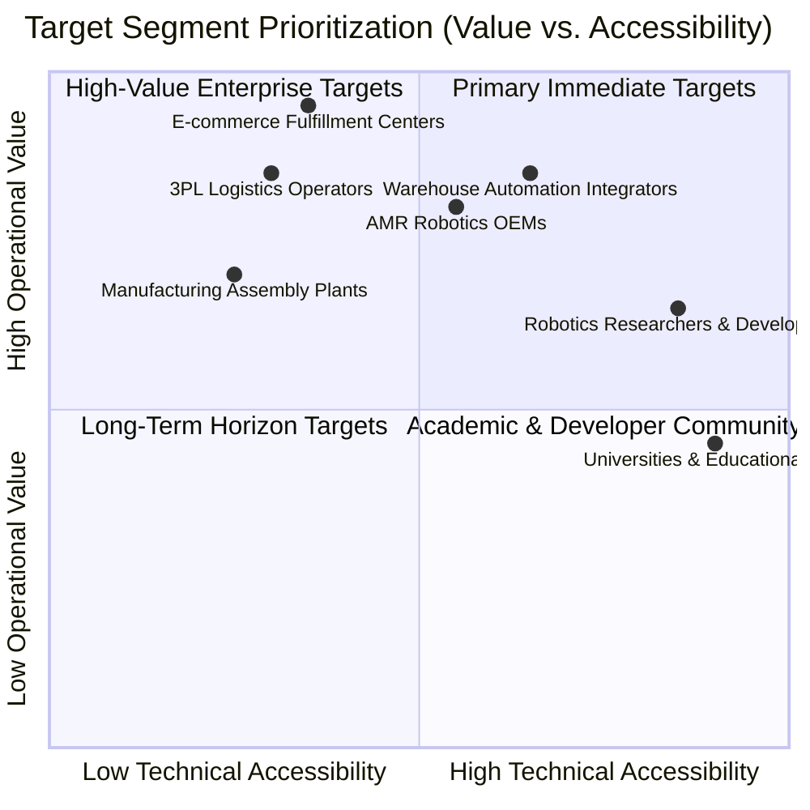

# SWARM — Target Users & Market Segments

> **Status:** IMPLEMENTED (Business Strategy & Market Analysis)  
> **Last Verified:** 2026-11-24  
> **Market Classification:** Commercial Target Analysis (Distinguishing Validated Early Adopters from Proposed Enterprise Markets)

---

## 1. Target Segment Overview

SWARM targets organizations and professionals involved in the design, deployment, operation, and study of autonomous mobile logistics fleets. The evaluation below rigorously assesses seven potential market segments, documenting their operational friction, current alternatives, and the exact value proposition offered by SWARM.

> [!IMPORTANT]
> **Market Distinction:** These segments represent evaluated commercial target markets and strategic expansion vectors. SWARM is currently a functional simulation platform and pre-commercial engineering prototype; none of these segments are yet under binding commercial enterprise contracts.

---

## 2. Comprehensive Segment Evaluation

---

### Segment 1: Robotics Researchers & Developers
- **Classification:** **PRIMARY IMMEDIATE TARGET USER**
- **User Type:** Multi-Agent Pathfinding (MAPF) researchers, robotics software engineers, algorithms developers.
- **Their Operational Problem:** Benchmarking multi-agent coordination algorithms on real-world edge cases (deadlocks, dynamic closures, hardware faults) is notoriously difficult. Existing academic simulators lack physical cargo custody concepts, while 3D physics simulators (Isaac Sim, Gazebo) are too computationally heavy to test 5,000-tick runs rapidly.
- **Current Alternatives:** Custom Python/C++ scripts, Moving AI benchmark grids, ROS 2 Nav2 simulation.
- **Their Needs:** Deterministic discrete-tick execution, time-travel seek/replay, reproducible seeds, and an inspectable wait-for graph.
- **How SWARM Helps:** Provides an instant, in-browser, zero-setup arena with pure algorithmic transparency, 196 passing unit/integration tests, and explicit reservation state tracking.
- **Potential Value:** Accelerates MAPF research and algorithmic prototyping by 10x; eliminates simulator setup overhead.

### Segment 2: Warehouse Automation Integrators
- **Classification:** **PRIMARY COMMERCIAL TARGET USER**
- **User Type:** System integrators (e.g., Bastian Solutions, Fortna, Swisslog, Dematic partners) who design and install automated material handling systems.
- **Their Operational Problem:** Integrators must size robot fleets, configure aisle widths, and place charging/docking stations before hardware is purchased. Miscalculating traffic bottlenecks leads to expensive physical modifications and delayed commissioning.
- **Current Alternatives:** High-cost proprietary simulation software (AutoMod, FlexSim, Demo3D) that costs \$20,000–\$50,000 per seat license and requires weeks of manual modeling.
- **Their Needs:** Rapid grid modeling, dynamic aisle closure stress testing, and congestion heatmaps to validate layouts during pre-sales engineering.
- **How SWARM Helps:** Offers rapid ASCII and grid layout importing, real-time stress testing up to 32 robots, and instant demonstration of narrow-aisle conflict resolution.
- **Potential Value:** Shortens client proposal turnaround from weeks to days; de-risks multi-million dollar automation bids.

### Segment 3: Robotics Companies & AMR OEMs
- **Classification:** **SECONDARY COMMERCIAL TARGET USER**
- **User Type:** Product managers, fleet software architects, and firmware teams at AMR manufacturers (e.g., companies building autonomous pallet jacks, shelf-lifters, and tote-movers).
- **Their Operational Problem:** Building proprietary fleet managers from scratch requires solving NP-hard coordination, deadlock resolution, and fault handling—diverting engineering focus away from robot hardware and perception.
- **Current Alternatives:** In-house developed central controllers, ROS 2 Nav2, or licensing expensive third-party fleet software.
- **Their Needs:** A reference coordination core that supports standardized protocols (such as VDA 5050) and handles topological gridlock without human intervention.
- **How SWARM Helps:** Demonstrates a modular, battle-tested coordination and deadlock recovery engine with proven invariants and zero commit rejections.
- **Potential Value:** Reduces time-to-market for new AMR fleet deployments by 6–12 months.

### Segment 4: Universities & Educational Institutions
- **Classification:** **PRIMARY ADOPTION & COMMUNITY VECTOR**
- **User Type:** Professors, graduate students, and undergraduate instructors in robotics, industrial engineering, computer science, and operations research.
- **Their Operational Problem:** Teaching multi-agent systems and logistics automation requires software that students can run immediately on personal laptops without requiring specialized GPUs or complex Linux dual-boot setups.
- **Current Alternatives:** Pure mathematical textbooks, toy grid problems, or heavy Linux/ROS virtual machines that break frequently during lab sessions.
- **Their Needs:** Modern browser-based UI, interactive step-by-step playback, visual deadlock inspection, and readable TypeScript source code.
- **How SWARM Helps:** Runs on any standard browser (Next.js/Canvas); students can inspect reservations, trigger faults, and test algorithms in real time.
- **Potential Value:** High viral distribution, pipeline for future robotics engineering talent, and academic citations.

### Segment 5: E-Commerce Fulfillment Centers
- **Classification:** **SECONDARY ENTERPRISE TARGET USER (Horizon 3)**
- **User Type:** Fulfillment operations directors, warehouse general managers, continuous improvement managers at high-velocity e-commerce operations.
- **Their Operational Problem:** Floor gridlocks and stalled carriers directly degrade Units Per Hour (UPH) and jeopardize same-day shipping SLAs. Stalled robots with stranded totes require manual operator floor walks.
- **Current Alternatives:** Proprietary closed-source fleet dashboards provided by robot vendors; manual supervisor intervention.
- **Their Needs:** Autonomous fault recovery, zero lost packages, live operational KPIs, and non-disruptive spill management.
- **How SWARM Helps:** Demonstrates autonomous deadlock backout and automated custody handovers, proving that manual floor interventions can be eliminated.
- **Potential Value:** Reduces AMR downtime by up to 80% and protects order fulfillment SLAs.

### Segment 6: Third-Party Logistics (3PL) & Warehouse Operators
- **Classification:** **SECONDARY ENTERPRISE TARGET USER (Horizon 3)**
- **User Type:** Operations executives managing multi-client distribution centers.
- **Their Operational Problem:** 3PLs operate on thin margins and frequently reconfigure warehouse layouts to accommodate changing client inventory, creating unexpected traffic bottlenecks.
- **Current Alternatives:** Trial-and-error physical floor adjustments and conservative robot speeds.
- **Their Needs:** Fast validation of layout changes and dynamic lane management.
- **How SWARM Helps:** Dynamic aisle closure and reopening without simulation resets allows 3PLs to model seasonal floor mutations instantly.
- **Potential Value:** Minimizes floor reconfiguration downtime and optimizes multi-client throughput.

### Segment 7: Manufacturing & Automotive Assembly Plants
- **Classification:** **LONG-TERM TARGET USER (Horizon 3)**
- **User Type:** Plant logistics managers coordinating Just-In-Time (JIT) parts delivery from warehouse storage to assembly lines.
- **Their Operational Problem:** A stalled parts-delivery robot can stop an entire automotive assembly line costing \$20,000–\$50,000 per minute of line downtime.
- **Current Alternatives:** Rigid magnetic tape AGVs, fixed conveyors, or dedicated overhead rails.
- **Their Needs:** High-reliability fleet coordination with prioritized right-of-way for mission-critical assembly components.
- **How SWARM Helps:** Priority-driven space-time planning ensures urgent assembly parts pre-empt general replenishment traffic.
- **Potential Value:** Prevents assembly line stoppages caused by internal logistics gridlocks.
