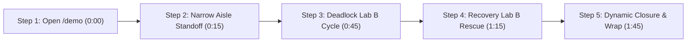

# SWARM — Live Product Demonstration Script & Contingency Guide

> **Status:** IMPLEMENTED  
> **Last Verified:** 2026-11-24  
> **Primary URL:** `http://localhost:3000/demo`  
> **Secondary Studio URL:** `http://localhost:3000/simulation`  
> **Target Execution Time:** 90–120 Seconds

---

## 1. Pre-Demo Setup & Environment Verification Checklist

Before starting the presentation:
- [ ] Ensure local Next.js development server is running (`npm run dev` or `npm start` on port 3000).
- [ ] Open Google Chrome in full-screen window (1920x1080 resolution recommended).
- [ ] Navigate to `http://localhost:3000/demo` in Tab 1.
- [ ] Navigate to `http://localhost:3000/simulation` in Tab 2 (as a deep-dive backup).
- [ ] Verify browser zoom is set to exactly 100%.
- [ ] Verify audio is clear and secondary displays do not crop the persistent sidebar.

---

## 2. Live Demo Script (Step-by-Step Sequence)

### Step 1: Open Demo Mode (0:00 – 0:15)
- **Action:** Open `http://localhost:3000/demo`.
- **What to Say:** *"Judges, let's look at the running product in our dedicated Demo Mode. Everything you see here is powered by our real deterministic simulation engine."*
- **What to Observe:** Clean scenario selection grid, top-down warehouse preview canvas, operational metrics strip, and playback bar.

### Step 2: Hero Scenario 1 — Narrow Aisle Conflict (0:15 – 0:45)
- **Action:** Click scenario card **"Narrow Aisle Standoff"** (`narrow-aisle`). Press **Start** (or Spacebar).
- **What to Say:** *"Here, two robots are assigned opposing missions through a one-cell-wide passage. Watch how SWARM's directed-edge reservation prevents an edge swap. The eastbound robot claims passage priority; the westbound robot stops cleanly outside the entrance until the corridor clears."*
- **What to Observe:** Eastbound robot moves through; westbound robot waits outside the aisle with status `waiting`. Zero head-on collision.

### Step 3: Hero Scenario 2 — 3-Robot Deadlock Recovery (0:45 – 1:15)
- **Action:** Select scenario **"Deadlock Lab B (3-Robot Cycle)"** (`lab-b-three-robot`). Click **Start**.
- **What to Say:** *"Now let's examine a circular wait at a 3-way intersection. All three robots are blocked in a cycle. Notice the incident queue flags Deadlock DL-0001. Tarjan's SCC algorithm identifies the participants. After four confirmation ticks, the lowest-priority candidate backs into a safe holding bay. The intersection unlocks autonomously."*
- **What to Observe:** Yellow incident banner triggers; yielder robot reverses into side pocket; the other two robots drive past; yielder resumes its journey.

### Step 4: Hero Scenario 3 — Package Custody Recovery (1:15 – 1:45)
- **Action:** Select scenario **"Recovery Lab B (Carrying Failure)"** (`rec-b-carrying`). Click **Start**.
- **What to Say:** *"Here is our crowning feature: atomic package custody. Robot R-01 picks up package PKG-0004 and suffers a motor breakdown mid-aisle. Watch the package status: it transitions to recovery-required, remaining strictly bound to R-01. Rescuer R-02 is dispatched, drives alongside, dwells for two ticks, and executes an atomic custody handover. R-02 finishes the delivery to Dock 3. Exactly once. Zero lost inventory."*
- **What to Observe:** R-01 glows red (failed); R-02 approaches, pauses for 2 ticks alongside, package icon transfers to R-02, delivery completes successfully.

### Step 5: Dynamic Aisle Closure & Conclusion (1:45 – 2:00)
- **Action:** Switch to Tab 2 (`/simulation`), click the **Close Aisle** button on the toolbar, and click a central corridor cell.
- **What to Say:** *"Finally, an operator can cordon off a spill in real time. Notice the red hazard stripe: active routes are invalidated and replanned immediately without resetting the simulation."*
- **What to Observe:** Approaching robot takes an alternate aisle smoothly.

---

## 3. Contingency & Troubleshooting Guide

| Issue / Glitch | Immediate Remediation Action | What to Say to Judges |
|---|---|---|
| **Accidental Pause / Simulation Stopped** | Press `Spacebar` or click the Play button on the playback bar. | *"Let's resume the simulation clock."* |
| **Canvas Off-Center / Zoom Mismatched** | Press `F` key (or click the Fit-to-Screen button on the canvas toolbar). | *"Let me center our view on the active fleet."* |
| **Browser Tab Freezes / High CPU** | Refresh browser tab (`Cmd + R` / `Ctrl + R`). State reloads in < 1 second. | *"Refreshing the canvas viewport—as you can see, the app initializes instantly."* |
| **Port 3000 Collision** | Run on alternate port: `npm run dev -- -p 3001`. | Keep demo pre-warmed before presenting. |
| **Local Server Fails Completely** | Open the pre-generated PDF pitch deck (`presentations/SWARM_Hackathon_Pitch_Deck.pdf`) featuring high-resolution screenshots. | *"While our local port re-binds, let's inspect the verified execution telemetry in our slides."* |
