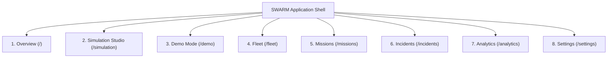

# SWARM — Complete Product Feature Overview

> **Status:** IMPLEMENTED (Source-Verified)  
> **Last Verified:** 2026-11-24  
> **Application Areas:** 8 Distinct Functional Views & Controls

---

## 1. Feature Navigation & Page Overview

SWARM provides a unified industrial control room interface across eight core functional surfaces:

---

## 2. Detailed Feature Breakdown

### 1. Overview Dashboard (`/`)
- **Fleet & Mission KPIs:** Real-time summary tiles displaying active robots, completed deliveries, waiting share percentage, and open incidents.
- **Live Warehouse Preview Canvas:** Compact, interactive top-down rendering of the active warehouse grid with robot positions and active closures.
- **System Activity Feed:** Live stream of recent engine decisions and operational warnings.
- **Quick-Start Scenario Cards:** One-click launch shortcuts into the Simulation Studio.

### 2. Simulation Studio (`/simulation`) — The Primary Experience
- **Interactive HTML5 2D Canvas:** Direct visual warehouse rendering with pan, zoom (0.5x to 3.0x), and auto-follow camera tracking.
- **Layer Visual Toggles:** Toggle display of coordinate coordinates, planned routes, space-time reservation footprints, and the active wait-for dependency graph.
- **Playback Control Strip:** Play, pause, single-tick advance, playback speed multiplier (0.5x, 1x, 2x, 5x), and time-travel scrubber.
- **Entity Inspector:** Click any robot, station, or package to inspect its internal state, battery charge, custody history, active plan steps, and blocked ticks.
- **Interactive Fault Injection Controls:**
  - `Close Aisle`: Select any aisle cell or run of cells to close dynamically.
  - `Fail Robot`: Select any active robot and inject one of five hardware failure types (`motor`, `battery`, `navigation`, `communication`, `emergency-stop`).
  - `Restore Robot`: Trigger repair and restoration sequence.
  - `Add Mission`: Dispatch ad-hoc customer transport orders between stations.

### 3. Judge Demo Mode (`/demo`)
- **Curated Scenario Selector:** Dedicated hackathon evaluation launcher featuring six seeded, reproducible scenarios.
- **Live Operational Timeline:** Displays timestamped narrative steps and milestones as the scenario unfolds.
- **Automated Completion State:** Automatically detects when all scenario missions have been completed or resolved, presenting a final performance scorecard.

### 4. Fleet Management (`/fleet`)
- **Status-Filtered Roster:** Complete inventory of all robots in the fleet, filterable by status (`idle`, `moving`, `carrying`, `waiting`, `failed`, `recovering`).
- **Battery Health Telemetry:** Visual battery level indicators and charging status.
- **Cumulative Robot Metrics:** Individual stats for distance traveled, busy ticks, waiting ticks, and completed deliveries.

### 5. Mission Operations Board (`/missions`)
- **Lifecycle Kanban & Table:** Tracks transport orders through all formal states (`queued`, `assigned`, `to-pickup`, `picking-up`, `carrying`, `to-dropoff`, `dropping-off`, `completed`, `cancelled`, `recovery-required`).
- **Priority Badges:** Color-coded urgency tags (`urgent` = red, `high` = amber, `normal` = blue).
- **New Mission Dispatcher:** Modal form to submit on-the-fly transport requests while the fleet is operating.

### 6. Incident Management Console (`/incidents`)
- **Deadlock Incident Queue:** Detailed logs of detected dependency cycles (`DL-nnnn`), listing involved robots, blocking coordinates, and recovery attempts.
- **Hardware Failure Records:** Complete log of machine faults (`F-nn`), listing failure cause, stranded package, and assigned rescuer.
- **Package Recovery Tasks:** Auditable view of open and completed cargo rescue missions (`RC-nn`).

### 7. Operational Analytics (`/analytics`)
- **Time-Windowed Throughput:** Bar charts tracking deliveries per 100-tick window.
- **Fleet Time Allocation:** Proportion of robot time spent moving, waiting, loading, charging, or faulted.
- **Movement-Density Heatmap:** Identifies high-traffic corridors and congestion bottlenecks across the warehouse floor based on retained movement history.
- **Recovery & Incident Metrics:** Summary counts of detected cycles, resolved deadlocks, and cargo handovers.

### 8. System Settings (`/settings`)
- **Tick Interval Configuration:** Adjust base tick duration (50 ms to 1,000 ms).
- **Motion Smoothing & Interpolation:** Toggle CSS/Canvas position interpolation for low-end devices.
- **Storage Management:** Reset stored preferences in browser `localStorage`.
