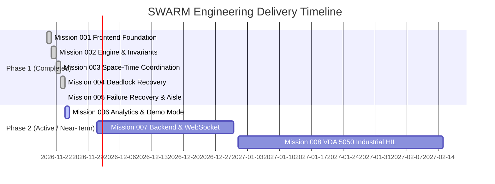

# SWARM — Product & Engineering Development Roadmap

> **Status:** IMPLEMENTED (Roadmap Specification)  
> **Last Verified:** 2026-11-24  
> **Active Milestone:** Mission 006 (Judging Polish & Metrics Verification)

---

## 1. Milestone Delivery Progress Overview

---

## 2. Completed Milestones (Verified in Codebase)

### Mission 001 — Frontend Foundation & Design System
- **Delivered:** Next.js 16 App Router setup, TypeScript strict configuration, Tailwind CSS v4 tokens, persistent industrial application shell, and initial Simulation Studio layout.
- **Status:** **COMPLETE** (Awaiting independent merge to `main`).

### Mission 002 — World Model & Deterministic Simulation Engine
- **Delivered:** Discrete-tick simulation loop, Mulberry32 seeded PRNG, typed warehouse layouts, basic spatial A\*, mission queues, package custody state transitions, and per-tick invariant assertions (`checkInvariants`).
- **Status:** **COMPLETE**.

### Mission 003 — Multi-Robot Space-Time Coordination
- **Delivered:** Time-indexed cell and directed-edge reservations (`ReservationTable`), 48-tick windowed Cooperative Space-Time A\*, dynamic priority aging, right-of-way preemption, and commit-time move resolution (`resolveMoves`).
- **Status:** **COMPLETE**.

### Mission 004 — Deadlock Detection & Autonomous Recovery
- **Delivered:** 6-cell route lookahead wait-for graph, Tarjan's SCC cycle detection, 4-tick persistence confirmation, candidate ranking, safe BFS holding bay yield maneuvers, and Deadlock Lab Scenarios A–E.
- **Status:** **COMPLETE**.

### Mission 005 — Robot Failure Recovery & Dynamic Aisle Replanning
- **Delivered:** Five industrial failure types, non-destructive mission preservation, atomic package custody handover to arriving rescuers, dynamic `close_aisle` and `reopen_aisle` commands, and Recovery Lab Scenarios A–F.
- **Status:** **COMPLETE**.

---

## 3. Active Milestone: Mission 006 (Current Focus)

- **Deliverables:**
  - Dedicated judge-facing Demo Mode (`/demo`) with curated scenario selector, live timeline, and completion state detection.
  - Operational Analytics dashboard (`/analytics`) with time-window, robot, and status filters.
  - Movement-density heatmaps derived from retained movement history.
  - Comprehensive documentation suite and pitch deck publication.
- **Current Status:** **IN PROGRESS / UNDER VERIFICATION**.

---

## 4. Future Milestones (Horizon 2 & Horizon 3)

### Mission 007 — FastAPI Backend & Real-Time WebSockets (Target: Q1 2027)
- [ ] Build standalone FastAPI service in Python 3.12 implementing the `SimulationSource` contract.
- [ ] Implement WebSocket server streaming high-frequency JSON snapshot telemetry.
- [ ] Add PostgreSQL database for persisting custom CAD layouts, historical runs, and benchmark statistics.

### Mission 008 — VDA 5050 Protocol & Industrial HIL Bridge (Target: Q2 2027)
- [ ] Implement VDA 5050 JSON trajectory serializer and MQTT publish/subscribe broker.
- [ ] Build Hardware-in-the-Loop (HIL) test harness connecting physical AMR simulators (Gazebo/Webots) to SWARM.
- [ ] Certify protocol compliance with VDMA 5050 v2.0 specifications.

### Mission 009 — Continuous-Space Kinematics & Multi-Floor Lifts (Target: Q3 2027)
- [ ] Add acceleration, deceleration, and turning radius kinematic curves.
- [ ] Model vertical freight elevators and multi-floor mezzanine ramps.
- [ ] Dynamic charging schedule optimization and predictive battery swapping.

### Mission 010 — Enterprise WMS/WES Connector (Target: Q4 2027)
- [ ] REST / GraphQL connectors for SAP Extended Warehouse Management (EWM) and Manhattan Associates WMS.
- [ ] Enterprise Single Sign-On (SSO) and Role-Based Access Control (RBAC).
