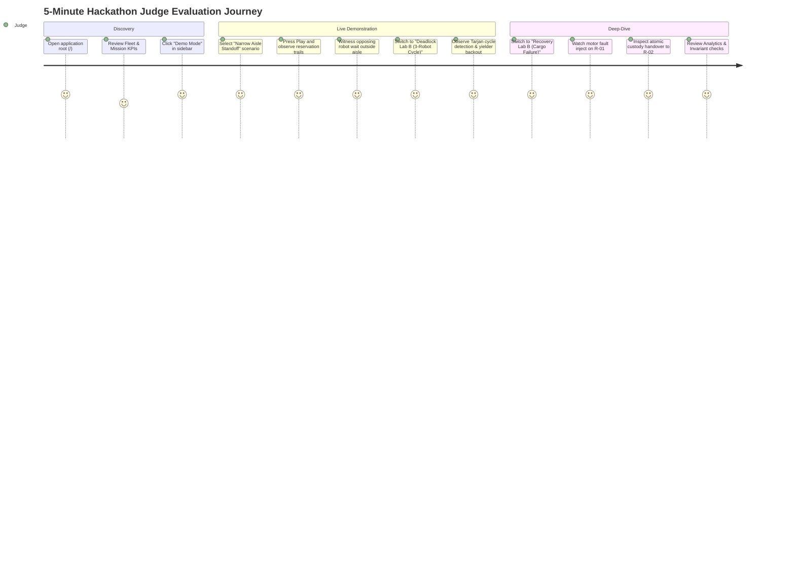

# SWARM — End-to-End User Journeys

> **Status:** IMPLEMENTED  
> **Last Verified:** 2026-11-24  
> **Personas Covered:** Warehouse Operator, Logistics Integrator, Hackathon Judge

---

## 1. Journey 1: The Hackathon Judge (Rapid Evaluation Journey)

1. **Arrival & Orientation (0:00–0:45):** The judge opens the application at `http://localhost:3000/`. They immediately observe that the platform is a fully functional industrial control dashboard, not a static presentation.
2. **Launching Demo Mode (0:45–1:30):** The judge clicks **Demo Mode** (`/demo`) in the sidebar, selects a seeded evaluation scenario, and presses **Start**.
3. **Observing Multi-Robot Coordination (1:30–2:30):** The judge watches robots navigate intersecting aisles. Glowing space-time reservation trails illustrate that robots coordinate trajectories before moving.
4. **Testing Injected Disruptions (2:30–3:45):** The judge navigates to **Simulation Studio** (`/simulation`), clicks on an active corridor, and closes an aisle. They watch active robots immediately replan around the obstruction without pausing or resetting the engine.
5. **Verifying Invariants & Audit (3:45–5:00):** The judge checks **Incidents** (`/incidents`) and **Analytics** (`/analytics`), confirming that 0 collisions occurred, zero packages were duplicated, and every state transition was logged with tick-accurate audit trails.

---

## 2. Journey 2: The Warehouse Operations Supervisor (Daily Operations)

1. **Shift Kickoff:** The supervisor opens the **Overview** dashboard on their tablet/desktop to check total active robots (e.g., 8 robots operational, 0 faulted).
2. **Dispatching Express Orders:** Customer places an urgent shipping request. The supervisor opens **Missions** (`/missions`), clicks **New Mission**, selects origin dock `S-01`, destination dock `S-04`, and marks priority as `urgent`.
3. **Observing Right-of-Way:** The supervisor navigates to **Simulation Studio** to watch the urgent carrier dispatch. They observe lower-priority robots yielding right-of-way at cross-junctions to let the urgent order pass.
4. **Handling Floor Incidents:** A pallet drops in Aisle 4. The supervisor uses the canvas closure tool to cordon off the aisle. They verify that approaching carriers smoothly divert down Aisle 5 without supervisor intervention.
5. **Shift Review:** At the end of the shift, the supervisor reviews the **Analytics** page to verify fleet utilization percentage, total delivered packages, and average waiting share.

---

## 3. Journey 3: The Robotics Algorithm Engineer (Edge-Case Debugging)

1. **Benchmarking New Heuristic:** The engineer loads the **High-Density** scenario (8 robots, heavy order feed) to stress-test coordination under high agent density.
2. **Inspecting Graph Dependencies:** The engineer enables the **Wait Graph Overlay** in canvas settings, visually tracking directed dependency edges between waiting robots.
3. **Reproducing a Standoff:** When a circular wait forms, the engineer pauses the engine, steps tick-by-tick using the playback bar, and inspects the `DeadlockIncident` record in the inspector.
4. **Time-Travel Seeking:** The engineer drags the timeline scrubber backwards to tick 40, verifying that the command log deterministically reconstructs earlier world states.
5. **Running CI Verification:** Before committing code changes, the engineer runs `npm run check` in their terminal, executing all 196 automated Vitest tests across coordination, deadlocks, and failure recovery.
