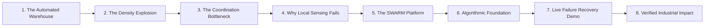

# SWARM — Hackathon Pitch Strategy & Positioning

> **Status:** IMPLEMENTED (Documentation & Strategy)  
> **Last Verified:** 2026-11-24  
> **Target Audience:** Hackathon Judges, Technical Evaluators, Industry Experts, Potential Angel Investors  
> **Product Working Name:** SWARM (Warehouse Robot Coordination Arena)  
> **Repository:** [`Antrikshcodes/swarm-robotics-simulator`](https://github.com/Antrikshcodes/swarm-robotics-simulator)  
> **Active Branch:** `feat/mission-001-frontend`

---

## 1. Pitch Positioning & Elevator Pitches

### One-Line Product Description
> **"SWARM is an autonomous warehouse fleet coordination and simulation arena that guarantees zero robot collisions, recovers deadlocks and machine failures in real time, and ensures atomic package custody across space and time."**

### 30-Second Elevator Pitch
> *"In modern automated warehouses, deploying dozens of Autonomous Mobile Robots (AMRs) usually leads to traffic chaos: narrow aisle standoffs, intersection deadlocks, and stranded cargo when robots fail. Existing fleet managers rely on reactive sensor braking or cloud pauses. SWARM solves this fundamentally. Built on a deterministic 11-phase discrete-tick engine, SWARM coordinates multi-robot space-time reservations, executes Tarjan-cycle deadlock resolution without human intervention, and guarantees atomic package custody handover when a carrier breaks down. One warehouse. Multiple robots. Zero collisions."*

### 60-Second Elevator Pitch
> *"E-commerce fulfillment centers lose thousands of productive hours every year because Autonomous Mobile Robots are treated as independent agents with localized obstacle avoidance. When two robots meet in a narrow aisle, they freeze. When a carrier suffers a motor breakdown mid-transit, its cargo is trapped and inventory records desynchronize.
> 
> SWARM transforms uncoordinated fleets into a synchronized, deterministic logistics machine. Our platform features windowed Space-Time A\* reservation planning, predictive edge-conflict elimination, real-time wait-for graph cycle detection that separates ordinary congestion from fatal deadlocks, and dynamic aisle rerouting without restarting the simulation. 
> 
> In benchmark tests with up to 32 robots, SWARM achieves sub-1.2 ms planning cycles with zero commit rejections. Best of all, judges can launch our live Demo Mode in their browser today to watch real autonomous fault recovery in action."*

### 3-Minute Pitch Structure
1. **The Hook (0:00–0:30):** The hidden bottleneck of modern warehouse automation—multi-robot traffic interference and cargo orphaning.
2. **The Flaw of Naive Navigation (0:30–1:00):** Why spatial A\* and lidar braking fail in high-density corridors; the mathematical inevitability of deadlocks.
3. **The SWARM Architecture (1:00–1:45):** 4D space-time reservations, Tarjan SCC deadlock resolution, atomic package custody state machine.
4. **Live Validation (1:45–2:30):** Quick walkthrough of `/demo` showing narrow-aisle conflict resolution and carrier motor failure handover.
5. **Impact & Roadmap (2:30–3:00):** Linear scalability (0.08 replans/robot/tick), transition to real-world AMR VDA 5050 middleware, and open-source industrial simulation.

### 5–7 Minute Pitch Positioning
The 5–7 minute format allows the presenter to transition seamlessly from industrial pain points to deep algorithmic defense, accompanied by a synchronized walkthrough of the running application (`http://localhost:3000/demo` and `http://localhost:3000/simulation`).

---

## 2. Core Narrative Arc

The winning pitch follows a tension-and-resolution narrative:

1. **The Modern Warehouse:** Global supply chains depend on autonomous mobile fleets running 24/7 in tightly packed grid fulfillment centers.
2. **The Rise of Autonomous Robots:** Facilities scale from 5 to 50+ mobile robots to meet razor-thin delivery windows.
3. **The Coordination Problem:** More robots in fixed floor space creates quadratic interaction complexity. Narrow aisles become single points of failure.
4. **Why Independent Navigation Fails:** When each robot plans selfishly using static 2D pathfinding and halts when lidar detects an obstacle, head-on stalemates and circular deadlocks freeze the entire facility.
5. **The SWARM Solution:** A centralized space-time coordinator that orchestrates movements before wheels turn, treating time as a physical dimension.
6. **How the Technology Works:** Windowed Cooperative A\*, time-indexed cell/edge reservations, Tarjan cycle detection, and custody state machines.
7. **Live Product Demonstration:** Real-time demonstration of dynamic aisle closure, live route recalculation, and carrier failure rescue.
8. **Real-World Applications:** From brownfield AGV upgrades to brownfield fulfillment retrofits and digital twin validation.
9. **Future Potential:** Standardization around VDA 5050 protocols, cloud telemetry, and hardware-in-the-loop validation.

---

## 3. Core Message

> **"SWARM transforms multiple independent warehouse robots into one intelligently coordinated fleet."**

Every slide, answer, and demonstration feature must tie back to this thesis: **coordination cannot be an afterthought left to bumper sensors; it must be mathematically scheduled in space and time.**

---

## 4. Judge Psychology & Audience Alignment

Different judges evaluate hackathon projects through distinct lenses. SWARM addresses each profile with tailored evidence:

| Judge Profile | Primary Concerns | Expected Evidence | SWARM Emphasis | Likely Questions |
|---|---|---|---|---|
| **Technical Judge (Robotics / Systems)** | Algorithmic rigor, determinism, time complexity, race condition safety | Clean code, unit tests, invariant checks, benchmarks | Space-time reservation tables, Tarjan SCC cycle detection, BFS holding bays, zero commit rejections | *"Why not centralized CBS (Conflict-Based Search)?"*, *"What happens when a robot slips?"* |
| **Product Judge (UX / Architecture)** | Clarity of workflows, UX polish, observability, industrial realism | Responsive desktop UI, actionable inspector, clear event feeds | Simulation Studio layout, live inspector, visual deadlock classification, replay timeline | *"Can warehouse floor operators understand this UI?"*, *"How does an operator override a robot?"* |
| **Business / Logistics Judge** | ROI, throughput degradation, downtime costs, market integration | Quantifiable downtime savings, package custody safety, realistic integration paths | Prevented gridlock hours, zero lost packages, VDA 5050 compatibility roadmap | *"How do you integrate with Manhattan Associates or SAP EWM?"*, *"What is the business model?"* |
| **Industry Expert (Warehouse Operations)** | Edge cases: pallet spills, broken motors, battery depletion | Dynamic aisle closures, graceful degradation, physical battery limits | Dynamic closure replanning (`close_aisle`), 5 failure types, atomic handover | *"What if a robot fails inside a one-way tunnel?"*, *"How are chargers managed?"* |

---

## 5. Pitch Differentiation & Competitive Moat

SWARM differentiates itself across seven verifiable functional vectors:

1. **Space-Time Reservations vs. Reactive Braking:** Robots reserve `(x, y, t)` coordinates and directed edges `(u, v, t)`. Conflicts are resolved before robots move, not after they bump.
2. **Deterministic Cycle Recovery vs. Arbitrary Pausing:** Tarjan's SCC algorithm identifies circular dependencies. Instead of halting the fleet or random backoff, SWARM ranks participants deterministically and guides a yielder into a verified BFS holding bay.
3. **Atomic Package Custody vs. Lost Inventory:** Packages possess explicit lifecycle states (`available`, `reserved`, `picked-up`, `in-transit`, `recovery-required`, `delivered`). When a robot fails, custody remains locked to the physical hardware until an adjacent rescuer executes an atomic transfer.
4. **Dynamic Aisle Closure Without Simulation Reset:** Closing an aisle invalidates intersecting reservations and immediately reroutes unaffected robots while maintaining physical invariants for robots already inside the closed zone.
5. **Pure Algorithmic Determinism:** Powered by seeded PRNG (`mulberry32`), exact fixed-tick loops, and replayable command logs from tick 0.
6. **Strict Invariant Enforcement:** Automated validation verifies after every single tick that no two robots occupy the same cell, traverse the same edge in reverse, or duplicate package ownership.
7. **Production-Grade Test Suite:** 15 test files with 196 passing automated Vitest checks covering edge swaps, long stress runs (3,000+ ticks), and multi-agent coordination.

---

## 6. Pitch Mistakes to Avoid

1. ❌ **Overexplaining Dijkstra/A\* Basics:** Judges already know graph search. Focus immediately on the 4D time reservation dimension and Tarjan SCC cycle resolution.
2. ❌ **Showing Feature Soup Without a Story:** Do not click buttons randomly. Follow a structured story: *Normal Flow → Injected Aisle Blockage → Deadlock Occurrence → Autonomous Recovery → Package Rescue*.
3. ❌ **Claiming Fabricated Performance:** Do not invent physical AMR benchmarks. Quote verified project metrics: *1.17 ms mean tick time at 32 robots, 0.08 replans/robot/tick, 196 passing tests*.
4. ❌ **Hiding Behind Mockups:** Avoid static slides. Demo the running browser interface (`/demo` or `/simulation`).
5. ❌ **Claiming Hardware Integration Exists:** Be upfront: SWARM is currently a high-fidelity simulation engine with architectural readiness for VDA 5050 AMR communication protocols.
6. ❌ **Neglecting Package Custody:** Warehouses care about inventory integrity even more than movement speed. Emphasize that zero packages are lost or duplicated.

---

## 7. Recommended Winning Pitch Strategy

1. **Start with the Live Dashboard (T-0):** Open with the Simulation Studio active on screen to immediately establish that SWARM is a real, working engineering artifact.
2. **Deliver the Hook in Under 40 Seconds:** Frame the multi-robot coordination problem as a multimillion-dollar industrial gridlock challenge.
3. **Execute the Two "Hero Scenarios":**
   - **Hero 1 (Deadlock Lab B or C):** Show circular wait detection, Tarjan SCC cycle identification, and autonomous yielding to a side bay.
   - **Hero 2 (Recovery Lab B or F):** Inject a motor failure into a package carrier; demonstrate atomic custody handover to an arriving rescuer.
4. **Show the Metrics Strip:** Point to throughput, waiting share, zero commit rejections, and live event timelines.
5. **Close on Scalability and Next Steps:** Highlight the 196-test automated test suite, linear scaling benchmarks, and the planned VDA 5050 enterprise integration bridge.
