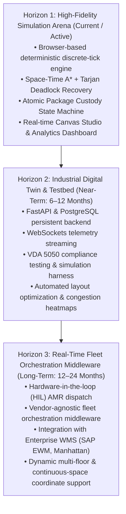

# SWARM — Product Vision & Strategic Direction

> **Status:** IMPLEMENTED (Vision & Roadmap)  
> **Last Verified:** 2026-11-24  
> **Scope:** Product Identity, Strategic Horizons & Commercial Roadmap

---

## 1. Product Vision Statement

> **"To become the universal coordination standard for autonomous industrial fleets—enabling mixed robot ecosystems to navigate shared human and machine environments with zero collisions, zero deadlocks, and zero lost packages."**

SWARM envisions a future where warehouse automation is not locked into monolithic, single-vendor hardware silos. As fulfillment centers deploy heterogeneous fleets of Automated Guided Vehicles (AGVs), Autonomous Mobile Robots (AMRs), and robotic forklifts, the critical bottleneck will not be robot mobility, but **vendor-agnostic coordination intelligence**. 

SWARM provides the deterministic operating core that turns chaotic multi-agent swarms into a synchronized, self-healing industrial choreography.

---

## 2. Product Mission

> **"SWARM develops mathematically rigorous, simulation-proven multi-agent fleet coordination algorithms that optimize logistics throughput, prevent spatial deadlocks, guarantee physical cargo custody, and empower warehouse operators with real-time operational transparency."**

---

## 3. The Core Promise

```
┌────────────────────────────────────────────────────────────────────────┐
│                        THE SWARM CORE PROMISE                         │
│                                                                        │
│   "Deploy any number of autonomous robots into your warehouse grid.    │
│    SWARM guarantees zero physical collisions, zero unrecovered cycles, │
│    and zero orphaned packages across continuous 24/7 operations."      │
└────────────────────────────────────────────────────────────────────────┘
```

---

## 4. Strategic Horizons

SWARM separates current software capabilities from long-term commercial goals across three distinct horizons:



### Horizon 1: High-Fidelity Simulation Arena (Current Status: IMPLEMENTED)
- **Target:** Robotics developers, academic researchers, and hackathon evaluators.
- **Form Factor:** In-browser, client-side, zero-install Next.js/Canvas application.
- **Core Capabilities:** 11-phase discrete-tick execution, 48-tick windowed space-time reservations, Tarjan SCC deadlock resolution, atomic package custody transfers, dynamic aisle closures, and 15 test files / 196 automated checks.

### Horizon 2: Industrial Digital Twin & Benchmarking Platform (Near-Term: PLANNED)
- **Target:** Warehouse automation integrators, facility planners, and AMR OEMs.
- **Form Factor:** Hybrid cloud/on-premise simulation engine backed by FastAPI, PostgreSQL, and WebSockets.
- **Core Capabilities:**
  - Automated layout benchmarking: evaluate picking throughput before physical rack installation.
  - VDA 5050 compliance test harness: validate third-party AMR firmware against simulated edge cases.
  - Historical playback and cross-scenario analytics archiving.

### Horizon 3: Enterprise Fleet Coordination Middleware (Long-Term: PLANNED)
- **Target:** Tier-1 e-commerce fulfillment centers, 3PL providers, and automotive manufacturing plants.
- **Form Factor:** High-availability edge orchestration server deployed inside warehouse server racks.
- **Core Capabilities:**
  - Direct integration with physical AMR fleets via standardized VDA 5050 MQTT messaging.
  - Two-way communication with enterprise Warehouse Management Systems (WMS / WES).
  - Continuous-space kinematic curves and dynamic multi-floor elevators.

---

## 5. Value to Stakeholders

### For Warehouse Operations Leaders
- **Guaranteed Throughput:** Eliminates catastrophic intersection gridlocks that shut down fulfillment zones for 20–45 minutes.
- **Inventory Audit Integrity:** Guarantees that damaged or stalled robots never leave "lost inventory" in limbo; custody handovers are audited down to the exact simulation tick.
- **Zero-Downtime Facility Adaptability:** Close maintenance aisles or cordon off spills on the fly without stopping active robot missions.

### For Robotics Developers & AMR Engineers
- **Rapid Edge-Case Stress Testing:** Reproduce rare multi-robot deadlock bugs deterministically in seconds using seeded PRNG and time-travel replay.
- **Clean Architectural Abstraction:** Clear separation of concerns between world model, pathfinding, reservations, deadlock detection, and presentation.
- **Algorithmic Defense:** Proven fallback mechanisms: when reservations cannot be found, robots safely wait, yield, or request recovery without memory leaks or process crashes.

### For Logistics Technology Integrators
- **De-Risked Commissioning:** Test warehouse grid configurations, docking layouts, and fleet sizing before investing millions of dollars in physical hardware.
- **Vendor Agnosticism:** Avoid proprietary vendor lock-in by utilizing open space-time coordination algorithms.
