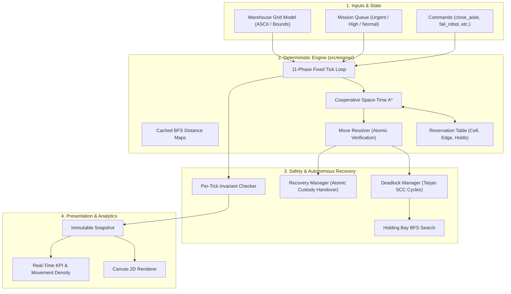

# SWARM — Solution Overview & Implementation Mapping

> **Status:** IMPLEMENTED  
> **Last Verified:** 2026-11-24  
> **Architecture Layer:** Engine, Coordination, Deadlock & Recovery Systems  
> **Primary Source References:** `src/engine/warehouse-engine.ts`, `src/engine/coordination/`, `src/engine/deadlock/`, `src/engine/recovery/`

---

## The SWARM Architecture Solution

SWARM (**Warehouse Robot Coordination Arena**) is an autonomous multi-robot coordination and simulation platform designed to eliminate fleet conflicts in constrained logistics environments.

Instead of treating robots as independent agents with localized reactive sensors, SWARM coordinates the entire fleet through a **centralized, discrete-tick, space-time reservation engine**. Every physical movement, reservation, handover, and route invalidation is governed by strict mathematical invariants and verified continuously by automated assertions.

---

## Problem-to-Solution Mapping Table

The following matrix maps every real-world warehouse challenge to its exact architectural solution, source code implementation, and verified status in SWARM:

| # | Warehouse Problem | Why It Matters | SWARM Solution Approach | Relevant Implementation | Current Status |
|---|---|---|---|---|---|
| **1** | **Shared Volume Congestion** | Quadratic interference halts warehouse picking throughput | Windowed Cooperative Space-Time A\* planning (48-tick horizon) with time-indexed cell reservations | `src/engine/coordination/space-time-planner.ts` `src/engine/coordination/reservation-table.ts` | **IMPLEMENTED** |
| **2** | **Path Intersection Conflicts** | Robots arriving at identical cells cause collisions or emergency stops | Centralized reservation table where each cell `(x, y)` is uniquely leased to one robot at tick `t` | `src/engine/coordination/reservation-table.ts` `src/engine/coordination/move-resolver.ts` | **IMPLEMENTED** |
| **3** | **Head-On Edge Swaps** | Robots swapping adjacent cells in opposite directions crash head-on | Directed-edge reservation table `(u -> v, t)`. Reversing a reserved directed edge is strictly rejected at plan time and commit time | `src/engine/coordination/reservation-table.ts:hasEdgeConflict` `src/engine/invariants.ts:checkInvariants` | **IMPLEMENTED** |
| **4** | **Circular Dependency Deadlocks** | 3+ robots in dependency loop freeze intersections permanently | Wait-for dependency graph constructed with 6-cell static route lookahead; Tarjan's SCC detects closed cycles | `src/engine/deadlock/wait-for-graph.ts` `src/engine/deadlock/deadlock-manager.ts` | **IMPLEMENTED** |
| **5** | **Congestion False Positives** | Normal pick queues trigger unnecessary detours if mistaken for deadlocks | 4-tick persistence filter (`confirmTicks=4`) + individual wait threshold (`>=4`). Transients tracked as metrics, not deadlocks | `src/engine/deadlock/deadlock-manager.ts:update` | **IMPLEMENTED** |
| **6** | **Deadlock Recovery & Standoffs** | Manual supervisor intervention required to unlock frozen robots | Candidate scoring (passage priority + convoys + mission urgency). Lowest score yields to nearest safe BFS holding bay | `src/engine/deadlock/deadlock-manager.ts` `src/engine/warehouse-engine.ts:findHolding` | **IMPLEMENTED** |
| **7** | **Mid-Transit Robot Failures** | Broken robot blocks aisle and strands active customer orders | Five explicit failure types (`motor`, `battery`, `navigation`, `communication`, `emergency-stop`). Cell held; crossing routes replanned | `src/engine/robots/robot-lifecycle.ts` `src/engine/recovery/recovery-manager.ts` | **IMPLEMENTED** |
| **8** | **Package Custody & Double-Delivery** | Reassigning stranded packages causes phantom inventory or duplicate deliveries | Finite custody state machine. Package remains physically locked to failed robot until an adjacent rescuer performs an atomic handover | `src/engine/custody/package-custody.ts` `src/engine/recovery/recovery-manager.ts` | **IMPLEMENTED** |
| **9** | **Dynamic Aisle Blockages** | Pallet spills or maintenance closures traditionally force simulation restarts | `close_aisle` command invalidates intersecting routes, releases future reservations, and triggers real-time replanning without reset | `src/engine/warehouse-engine.ts:closeAisle` `src/engine/coordination/coordinator.ts:invalidate` | **IMPLEMENTED** |
| **10** | **Fleet Starvation & Priority** | Low-priority batch movements block urgent customer shipments | Priority formula: Urgency (10/30/60) + Carry bonus (+5) + Waiting aging (+2/tick, max 24). Right-of-way preemption after 3 blocked ticks | `src/engine/missions/mission-lifecycle.ts` `src/engine/coordination/coordinator.ts:checkPreemption` | **IMPLEMENTED** |
| **11** | **Simulation Non-Determinism** | Bugs cannot be reproduced if random numbers drive simulation | Seeded PRNG (`mulberry32`), fixed 11-phase discrete-tick execution, command log replay from tick 0 | `src/engine/core/prng.ts` `src/engine/warehouse-engine.ts:step` | **IMPLEMENTED** |
| **12** | **Physical Hardware Integration** | Simulators fail to reflect real AMR kinematics and industrial standards | Standardized VDA 5050 JSON payload schema and hardware-in-the-loop bridge | `docs/technical/API_OVERVIEW.md` | **PLANNED** |

---

## Core Algorithmic Tenets

### 1. Space-Time Coordinate Reservations
In SWARM, pathfinding is not performed on a 2D grid $G = (V, E)$. Instead, it is evaluated across a 3D space-time graph $G_{ST} = (V \times T, E_{ST})$. A node is a tuple `((x, y), t)`, representing physical cell coordinates at a discrete tick $t$.
- A move action advances spatial coordinate and increments time: `((x, y), t) -> ((x', y'), t + 1)`.
- A wait action maintains spatial coordinate while incrementing time: `((x, y), t) -> ((x, y), t + 1)`.
- Both actions reserve the destination cell at tick $t+1$ and the directed transition edge `((x, y) -> (x', y'), t+1)`.

### 2. Multi-Robot Prioritization & Replanning Windows
Robots plan sequentially in descending priority order. Higher-priority robots reserve optimal space-time trajectories. Lower-priority robots plan around those reservations, inserting planned waits or detouring through alternative aisles. To keep computation bounded, robots plan within a **48-tick window** and are replanned only when:
- Their goal changes (new mission assigned or handover target reached).
- Their remaining plan drops below 3 ticks.
- Their path is invalidated by an aisle closure or robot failure.
- They have waited for 6 consecutive ticks.

This keeps planning frequency at approximately **0.08 plans per robot per tick**, enabling linear scaling up to 32 robots on modest hardware.

### 3. Tarjan SCC Deadlock Detection with Route Lookahead
On a 4-connected grid, two robots only block each other directly if they face each other. Circular deadlocks involving three or more robots occur because each robot's *future intended path* is blocked by the current or held position of another. 

SWARM builds a **wait-for graph** every tick using a **6-cell static route lookahead**. If an edge chain forms a closed cycle, Tarjan's Strongly Connected Components (SCC) algorithm identifies all participating robots. The deadlock manager verifies that the cycle persists for 4 consecutive ticks to rule out transient congestion, then triggers an autonomous yielding maneuver.

### 4. Atomic Custody Transfer
Custody of packages is governed by an explicit finite state machine:
$$\text{available} \longleftrightarrow \text{reserved} \longrightarrow \text{picked-up} \longrightarrow \text{in-transit} \longrightarrow \text{delivered}$$
When a robot fails while in `picked-up` or `in-transit` status:
$$\text{in-transit} \longrightarrow \text{recovery-required} \longrightarrow \text{in-transit}$$
The package is never returned to the open queue. It remains physically bound to `failedRobotId` while an adjacent rescuer (`rescuerId`) is assigned. Only when the rescuer arrives in an adjacent cell and completes the 2-tick handover dwell does the atomic function `transferCustody()` execute, updating package holder, mission assignment, and audit records in a single synchronous operation.
