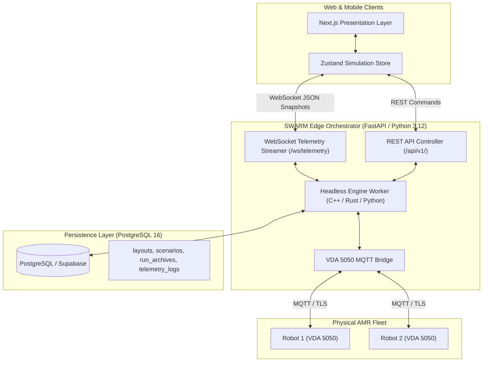

# SWARM — Backend Architecture & Future Integration Strategy

> **Status:** NOT IMPLEMENTED (Current Status) / PLANNED (Architectural Target)  
> **Last Verified:** 2026-11-24  
> **Current Execution Mode:** In-Browser Client-Side Engine (Zero Remote Backend Dependencies)

---

## 1. Current State: In-Browser Deterministic Engine

> [!IMPORTANT]
> **Implementation Truth:** In the current version of SWARM (`feat/mission-001-frontend`), **there is no remote backend server, database, or cloud API running**. 
> 
> The entire simulation engine (`WarehouseEngine`), pathfinding algorithms, reservation tables, deadlock detection, and failure recovery logic execute **100% locally within the client browser’s TypeScript/V8 runtime**.

### Why In-Browser First?
1. **Zero-Latency Responsiveness:** Eliminates network packet round-trips for high-frequency tick loops (up to 20 ticks per second).
2. **Instant Accessibility:** Hackathon evaluators, researchers, and prospective clients can run the full arena immediately in any modern web browser without installing Docker, Python dependencies, or database migrations.
3. **Pure Algorithmic Determinism:** Eliminates distributed network race conditions while validating core coordination invariants.

---

## 2. Architectural Boundary & Seamless Backend Transition

Although the backend is not yet implemented, the frontend was specifically engineered with a strict abstraction boundary: the **`SimulationSource` Interface** (`src/engine/warehouse-engine.ts`):

```ts
export interface SimulationSource {
  readonly scenarioId: string;
  getSnapshot(): SimulationSnapshot;
  step(): SimulationSnapshot;
  reset(): SimulationSnapshot;
  seek(tick: number): SimulationSnapshot;
  dispatch(command: EngineCommand): CommandResult;
}
```

Because all UI components communicate exclusively through this interface via `simulation-store.ts`, migrating to a remote cloud or edge backend requires **zero changes to presentation components**:
- The client-side `WarehouseEngine` will simply be swapped for a `RemoteSimulationSource` that proxies commands over WebSockets.

---

## 3. Planned Horizon 2 & 3 Backend Architecture



---

## 4. Planned Backend Capabilities (Roadmap)

### A. Headless High-Throughput Engine Service
- Compiled C++ / Rust or high-performance Python engine instance capable of simulating 100+ robots across 1,000,000 sq. ft. facilities.
- Multi-tenant cloud execution allowing automated layout batch evaluations in parallel.

### B. Durable Relational Persistence (PostgreSQL / Supabase)
- **Layout Repository:** Storage of customer CAD drawings, DXF files, and ASCII grid topologies.
- **Run Archive:** Persistent storage of 10,000+ tick operational runs for cross-scenario analytics and regression comparison.
- **Audit Logs:** Long-term archival of package custody transfers and failure incident records for enterprise compliance.

### C. VDA 5050 Industrial Protocol Bridge
- Translation of SWARM space-time trajectories into standard VDA 5050 JSON action and order messages.
- Hardware telemetry ingestion: receiving physical AMR battery voltage, wheel slip warnings, and E-stop triggers in real time.
