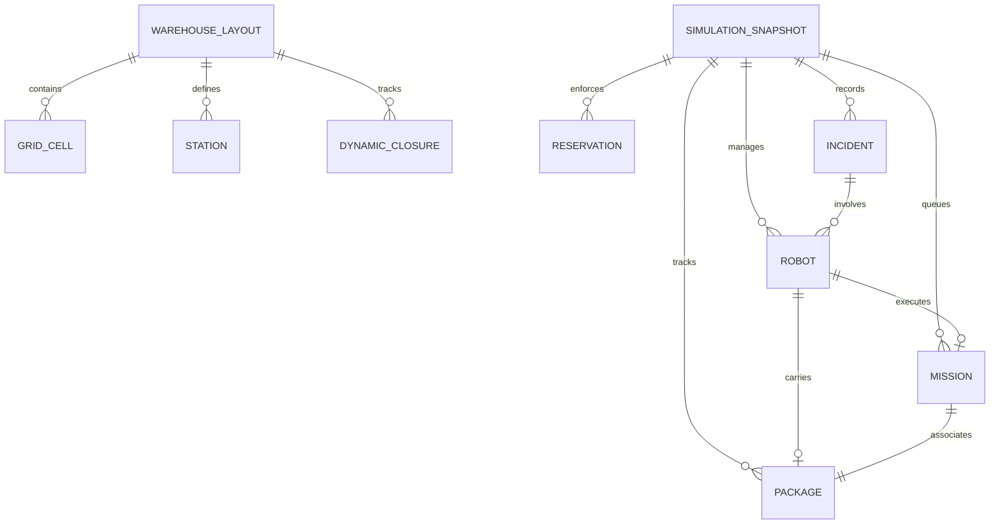

# SWARM — Data Model & Schema Specification

> **Status:** IMPLEMENTED (Source-Verified)  
> **Last Verified:** 2026-11-24  
> **Primary Source File:** `src/types/simulation.ts`

---

## 1. Domain Entities & Type Definitions

SWARM models warehouse logistics through strictly typed TypeScript interfaces. All domain entities use immutable data structures; when the simulation advances, new snapshot trees are constructed without mutating previous states.



---

## 2. Core Entity Schemas

### A. Robot Entity (`Robot`)
Represents an autonomous mobile robot on the warehouse floor.

```ts
interface Robot {
  id: string;                      // Stable identifier (e.g., "R-01")
  name: string;                    // Human-readable display label
  position: GridPoint;             // Current physical coordinate { x, y }
  previousPosition: GridPoint;     // Position at previous tick (for smooth visual interpolation)
  heading: Heading;                // Direction ("north" | "east" | "south" | "west")
  status: RobotStatus;             // "idle" | "moving" | "carrying" | "waiting" | 
                                   // "loading" | "unloading" | "charging" | "failed" | "recovering"
  action: RobotAction;             // Current micro-action (e.g., "travel-to-pickup", "yielding")
  battery: number;                 // Remaining battery charge (0.0 to 100.0)
  home: GridPoint;                 // Assigned resting or home charging station
  missionId: string | null;        // Active assigned mission ID
  packageId: string | null;        // Active carried package ID
  destination: GridPoint | null;   // Target coordinate
  route: GridPoint[];              // Remaining planned spatial path
  plan: PlanStep[];                // Reserved space-time steps [{ tick, x, y }]
  planStatus: PlanStatus;          // "complete" | "partial" | "blocked" | "unreachable" | "none"
  priority: number;                // Computed movement priority (Urgency + Carry + Aging)
  coordination: RobotCoordination; // Internal coordination flag ("ok" | "waiting" | "recovering")
  waitingFor: string | null;       // ID of robot currently blocking this agent
  blockedTicks: number;            // Number of consecutive ticks spent waiting
  activityNote: string;            // Real-time human-readable activity description
  waitClass: WaitClass;            // "none" | "waiting" | "congestion" | "deadlock" | "recovering" | "yielding"
  deadlockId: string | null;       // Associated deadlock incident ID (if in cycle)
  failure: RobotFailure | null;    // Active failure record (if status is failed/recovering)
  recoveryRole: RecoveryRole | null; // Role in cargo rescue ("holder" | "rescuer")
  stats: RobotStats;               // Cumulative metrics (movingTicks, distance, deliveries, etc.)
}
```

### B. Package Entity (`Package`)
Represents an inventory item transported across the warehouse.

```ts
interface Package {
  id: string;                      // Stable package identifier (e.g., "PKG-0004")
  missionId: string;               // Associated mission ID
  originStationId: string;         // Pickup station ID
  destinationStationId: string;    // Drop-off dock ID
  custody: PackageCustodyState;    // "available" | "reserved" | "picked-up" | 
                                   // "in-transit" | "recovery-required" | "delivered"
  holderRobotId: string | null;    // Robot currently possessing custody
  location: GridPoint;             // Current physical coordinates
  custodyHistory: CustodyRecord[]; // Audit trail of all custody transitions
  recovery: PackageRecoveryInfo | null; // Active rescue info (failedRobotId, taskId, rescuerId)
}
```

### C. Mission Entity (`Mission`)
Represents a transport order from pickup to delivery.

```ts
interface Mission {
  id: string;                      // Stable mission identifier (e.g., "MSN-0001")
  priority: MissionPriority;       // "normal" (10) | "high" (30) | "urgent" (60)
  state: MissionState;             // "queued" | "assigned" | "to-pickup" | "picking-up" | 
                                   // "carrying" | "to-dropoff" | "dropping-off" | 
                                   // "completed" | "cancelled" | "recovery-required"
  robotId: string | null;          // Assigned carrier ID
  pickupStationId: string;         // Origin dock
  dropoffStationId: string;        // Destination dock
  createdTick: number;             // Timestamp created
  assignedTick: number | null;     // Timestamp assigned
  completedTick: number | null;    // Timestamp completed
  cancelledTick: number | null;    // Timestamp cancelled
  history: MissionTransitionRecord[]; // Full timestamped transition history
}
```

### D. Deadlock Incident (`DeadlockIncident`)
Represents an identified dependency cycle or stall.

```ts
interface DeadlockIncident {
  id: string;                      // "DL-nnnn"
  kind: "cycle" | "stall";         // Topological cycle vs single-robot stall
  status: "detected" | "recovering" | "resolved" | "failed";
  robots: string[];                // Robot IDs forming the cycle
  dependents: string[];            // Robot IDs queued behind the cycle
  edges: DeadlockEdge[];           // Directed dependency edges A -> B
  blockingCells: GridPoint[];      // Specific coordinates where contention occurs
  detectedTick: number;            // Timestamp detected
  resolvedTick: number | null;     // Timestamp resolved
  attempts: RecoveryAttempt[];     // History of yield attempts
  failureReason?: string;          // Reason if recovery failed (e.g., "no-holding-position")
}
```

### E. Dynamic Closure (`AisleClosure`)
Represents dynamic floor blockages (spills, maintenance).

```ts
interface AisleClosure {
  id: string;                      // "CL-nn"
  cells: GridPoint[];              // Impassable cell coordinates
  label: string;                   // Human-readable reason (e.g., "Pallet Spill")
  createdTick: number;             // Timestamp applied
}
```
