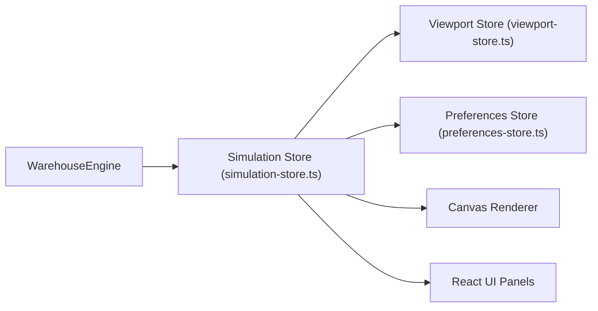

# SWARM — Frontend Architecture & Canvas Rendering

> **Status:** IMPLEMENTED (Source-Verified)  
> **Last Verified:** 2026-11-24  
> **Framework:** Next.js 16.4.6 (App Router), React 19.3.0, Zustand 5.1.0, HTML5 Canvas 2D

---

## 1. Application Shell & Routing Structure

SWARM uses Next.js 16 App Router with an industrial desktop-first layout. Navigation is anchored by a persistent collapsible sidebar (`src/components/navigation/sidebar.tsx`):

```
src/app/
├── layout.tsx              // Root HTML shell, metadata, MotionProvider, PlaybackDriver
├── page.tsx                // / (Overview Dashboard: fleet summary, KPIs, mini preview)
├── simulation/page.tsx     // /simulation (Full Simulation Studio: Canvas, Inspector, Controls)
├── demo/page.tsx           // /demo (Judge-facing scenario launcher, live preview, timeline)
├── fleet/page.tsx          // /fleet (Roster view, battery meters, status filters)
├── missions/page.tsx       // /missions (Lifecycle board, new mission dispatch modal)
├── incidents/page.tsx      // /incidents (Deadlock incident queue, failure recovery logs)
├── analytics/page.tsx      // /analytics (Throughput charts, time allocation, movement density)
├── settings/page.tsx       // /settings (Tick duration, motion smoothing, display options)
└── not-found.tsx           // 404 error page
```

---

## 2. State Management Architecture (Zustand Stores)

SWARM strictly separates simulation state from local UI preferences using three focused Zustand stores:



1. **`simulation-store.ts`:**
   - Holds the current authoritative `SimulationSnapshot`.
   - Bridges user actions to engine commands (`start`, `pause`, `step`, `reset`, `close_aisle`, `fail_robot`).
   - Maintains execution status (`isRunning`, `playbackSpeed`, `selectedRobotId`).
2. **`preferences-store.ts`:**
   - Persists user options to browser `localStorage`.
   - Controls canvas layer toggles (show routes, show reservations, show wait graph, show coordinates).
   - Configures tick duration (50 ms to 1,000 ms) and motion interpolation.
3. **`viewport-store.ts`:**
   - Controls Canvas zoom level (0.5x to 3.0x), pan offset `(panX, panY)`, and auto-centering on selected robots.

---

## 3. High-Performance Canvas 2D Rendering

Rendering 30+ robots with spatial routes, coordinate grids, and dynamic reservations inside standard React DOM nodes would cause severe DOM thrashing. SWARM implements a dedicated **HTML5 Canvas 2D Renderer** (`src/lib/render/warehouse-renderer.ts`):

### Pure Functional Design
The renderer is a pure function with zero internal mutable state:
```ts
export function renderWarehouse(
  ctx: CanvasRenderingContext2D,
  snapshot: SimulationSnapshot,
  view: ViewportState,
  options: RenderOptions
): void;
```

### Rendering Pipeline (Layer Order)
Every animation frame executes a clear, layered paint sequence:
1. **Clear & Background:** Clears context with dark slate background (`#090d16`).
2. **Grid Lines:** Draws subtle grid boundaries at cell pitch (default 40px/cell).
3. **Storage Racks & Pillars:** Renders textured rack cells with industrial crosshatching.
4. **Stations & Docks:** Renders pickup docks (blue accent), drop-off docks (emerald accent), and charging stations (amber accent) with coordinate labels.
5. **Dynamic Closures:** Renders red hazard-striped diagonal overlays over closed cells.
6. **Time Reservations (Optional):** Renders transparent glowing footprints of future reserved cells.
7. **Planned Routes:** Draws antialiased vector polylines connecting future waypoints for the selected robot.
8. **Wait-For Dependency Graph (Optional):** Draws colored directional arrows indicating active blockages.
9. **Robot Entities:**
   - Interpolates physical position smoothly between `previousPosition` and `position` during active animation.
   - Paints directional robot chassis, battery level rings, status halos, and carried package markers.
10. **Hover & Selection Overlays:** Highlights the currently inspected robot or hovered grid coordinate.

---

## 4. Playback Driver & Animation Decoupling

Timing is managed by `PlaybackDriver` (`src/components/layout/playback-driver.tsx`):
- Uses `requestAnimationFrame` to maintain smooth 60 FPS visual interpolation.
- Calculates elapsed time and calls `step()` when the user-selected tick interval (e.g., 200 ms) elapses.
- **Decoupling Guarantee:** If the browser tab loses focus or frame rate drops, the engine remains 100% deterministic; simulation time never slips or speeds up unpredictably.

---

## 5. 3D Simulation Studio: Inspection & Selection (Mission 007)

The 3D view (`src/components/simulation/scene3d/`) and the 2D canvas are two views of one engine snapshot. They also share one **selection model**, held in `simulation-store` as `selection: EntitySelection | null`.

### Selection model

`EntitySelection` (`src/types/simulation.ts`) is one of:

- `robot` (id)
- `station` (id)
- `rack` (x, y)
- `obstacle` (x, y)
- `cell` (x, y)

Racks and obstacles are addressed by the picked cell; the inspector resolves the whole connected block. Selection is **UI state only**:

- `select()` never mutates the engine.
- The only engine call is the existing read-only `select-robot` existence check.
- `src/store/selection.test.ts` asserts that the snapshot object, tick, playback status and timeline extent are unchanged after selecting every kind.

| Concern | Module |
|---|---|
| Cell → selection (station, rack, obstacle, or cell), shared by 2D hit-testing and 3D picking | `selectionForCell()` in `src/lib/inspection.ts` |
| Entity data for the inspector (pure, unit-tested) | `inspectRobot`, `inspectStation`, `inspectBlock`, `inspectCell`, `resolveSelection` in `src/lib/inspection.ts` |
| 3D picking | `BlockPickers` (one invisible instanced box per rack / obstacle cell), the floor plane (open cells, stations), and one invisible hit box per robot |
| Hover (no React renders per pointer move) | `scene3d/hover-store.ts`, read imperatively by `HoverHighlight`, the cursor and the hover readout |
| Selected highlight | `SelectionHighlight`: lime box edges for rack blocks and obstacles, floor brackets for cells and stations, plus a footprint fill. Robots keep their lime ring. In 2D, `drawBrackets` around the same cells |
| Inspector panel | `components/simulation/inspector.tsx`, which resolves the selection once and renders `RobotInspector`, `StationInspector`, `BlockInspector` or `CellInspector`, with an enter-only transition (reduced motion respected through `MotionConfig`) |
| Camera actions | `cameraActions` in `scene3d/camera-store.ts`: `focusRobot`, `followRobot`, `returnToOverview`, `focusRegion` |

### Interactions

- **Click to select.** Overlapping objects resolve to the nearest hit: a robot in front of a rack wins; a rack hides the floor behind it.
- **Click empty space** (outside the warehouse slab) or press **Escape** to clear.
- **Double-click a robot** to follow it.
- **Inspector robot links** are buttons, so robots can also be selected with the keyboard.
- **Scenario switch** clears the selection. Switching between 2D and 3D keeps it.

### Data honesty

The engine models racks as blocked cells. It has no inventory, storage levels or bin occupancy, so the rack inspector says "not modelled", and the 3D levels and totes are described there as decorative. Rack "IDs" are derived from the block's corner cells (for example `P5–T6`), because the engine has none.

### Camera

`src/lib/scene3d/camera-fit.ts` holds the pure camera maths:

- **Fixed presets** (isometric, overview, top) solve the camera distance in closed form, so that every corner of the warehouse volume fits the frustum at the current aspect.
- The orbit target is then re-centred on the projected extents.
- The volume height is the actual racking height, so cut-away labs frame tighter.
- **Transitions** ease (cubic) over 850 ms. The target moves linearly while the camera's offset interpolates in spherical coordinates, so it arcs rather than cutting through racking. With reduced motion, transitions are instant.
- **Region focus** frames a rack block, station or cell from the current direction.
- Follow and chase are unchanged.

### Rendering costs

See [PERFORMANCE_3D.md](PERFORMANCE_3D.md) for the measured results and the harness (`npm run perf:3d`). In summary:

- The shared robot model merges same-material parts and has a distance LOD.
- Stations and closures are instanced.
- Picking uses proxy volumes, not the visible meshes.
- Adaptive DPR never exceeds the display's pixel ratio.
- Frames are rendered on demand only, as before.

