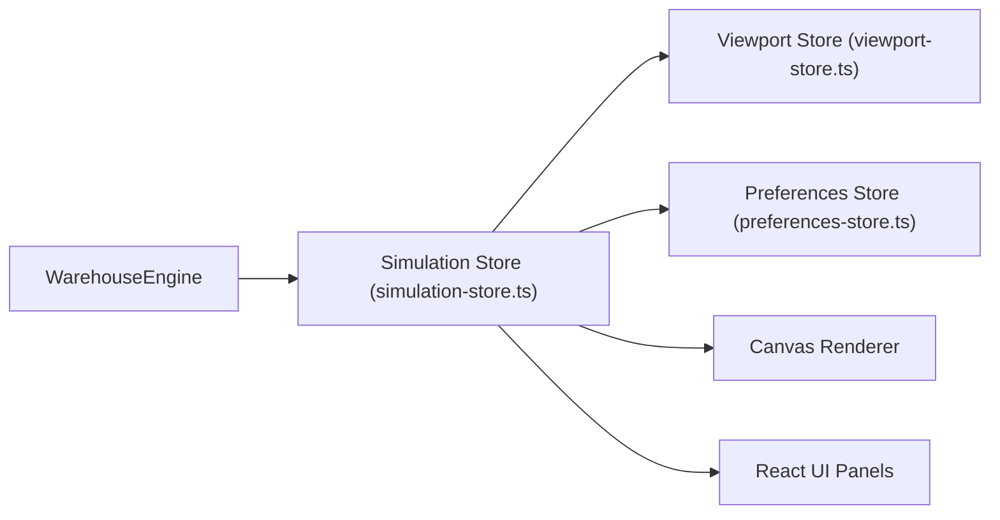

# SWARM — Frontend Architecture & Canvas Rendering

> **Status:** IMPLEMENTED (Source-Verified)  
> **Last Verified:** 2026-11-24  
> **Framework:** Next.js 16.4.6 (App Router), React 19.3.0, Zustand 5.1.0, HTML5 Canvas 2D

---

## 1. Application Shell & Routing Structure

SWARM uses Next.js 16 App Router with an industrial desktop-first layout. Navigation is anchored by a persistent collapsible sidebar (`src/components/navigation/sidebar.tsx`):

```
src/app/
├── layout.tsx              // Root HTML shell, metadata, MotionProvider, PlaybackDriver
├── page.tsx                // / (Overview Dashboard: fleet summary, KPIs, mini preview)
├── simulation/page.tsx     // /simulation (Full Simulation Studio: Canvas, Inspector, Controls)
├── demo/page.tsx           // /demo (Judge-facing scenario launcher, live preview, timeline)
├── fleet/page.tsx          // /fleet (Roster view, battery meters, status filters)
├── missions/page.tsx       // /missions (Lifecycle board, new mission dispatch modal)
├── incidents/page.tsx      // /incidents (Deadlock incident queue, failure recovery logs)
├── analytics/page.tsx      // /analytics (Throughput charts, time allocation, movement density)
├── settings/page.tsx       // /settings (Tick duration, motion smoothing, display options)
└── not-found.tsx           // 404 error page
```

---

## 2. State Management Architecture (Zustand Stores)

SWARM strictly separates simulation state from local UI preferences using three focused Zustand stores:



1. **`simulation-store.ts`:**
   - Holds the current authoritative `SimulationSnapshot`.
   - Bridges user actions to engine commands (`start`, `pause`, `step`, `reset`, `close_aisle`, `fail_robot`).
   - Maintains execution status (`isRunning`, `playbackSpeed`, `selectedRobotId`).
2. **`preferences-store.ts`:**
   - Persists user options to browser `localStorage`.
   - Controls canvas layer toggles (show routes, show reservations, show wait graph, show coordinates).
   - Configures tick duration (50 ms to 1,000 ms) and motion interpolation.
3. **`viewport-store.ts`:**
   - Controls Canvas zoom level (0.5x to 3.0x), pan offset `(panX, panY)`, and auto-centering on selected robots.

---

## 3. High-Performance Canvas 2D Rendering

Rendering 30+ robots with spatial routes, coordinate grids, and dynamic reservations inside standard React DOM nodes would cause severe DOM thrashing. SWARM implements a dedicated **HTML5 Canvas 2D Renderer** (`src/lib/render/warehouse-renderer.ts`):

### Pure Functional Design
The renderer is a pure function with zero internal mutable state:
```ts
export function renderWarehouse(
  ctx: CanvasRenderingContext2D,
  snapshot: SimulationSnapshot,
  view: ViewportState,
  options: RenderOptions
): void;
```

### Rendering Pipeline (Layer Order)
Every animation frame executes a clear, layered paint sequence:
1. **Clear & Background:** Clears context with dark slate background (`#090d16`).
2. **Grid Lines:** Draws subtle grid boundaries at cell pitch (default 40px/cell).
3. **Storage Racks & Pillars:** Renders textured rack cells with industrial crosshatching.
4. **Stations & Docks:** Renders pickup docks (blue accent), drop-off docks (emerald accent), and charging stations (amber accent) with coordinate labels.
5. **Dynamic Closures:** Renders red hazard-striped diagonal overlays over closed cells.
6. **Time Reservations (Optional):** Renders transparent glowing footprints of future reserved cells.
7. **Planned Routes:** Draws antialiased vector polylines connecting future waypoints for the selected robot.
8. **Wait-For Dependency Graph (Optional):** Draws colored directional arrows indicating active blockages.
9. **Robot Entities:**
   - Interpolates physical position smoothly between `previousPosition` and `position` during active animation.
   - Paints directional robot chassis, battery level rings, status halos, and carried package markers.
10. **Hover & Selection Overlays:** Highlights the currently inspected robot or hovered grid coordinate.

---

## 4. Playback Driver & Animation Decoupling

Timing is managed by `PlaybackDriver` (`src/components/layout/playback-driver.tsx`):
- Uses `requestAnimationFrame` to maintain smooth 60 FPS visual interpolation.
- Calculates elapsed time and calls `step()` when the user-selected tick interval (e.g., 200 ms) elapses.
- **Decoupling Guarantee:** If the browser tab loses focus or frame rate drops, the engine remains 100% deterministic; simulation time never slips or speeds up unpredictably.
