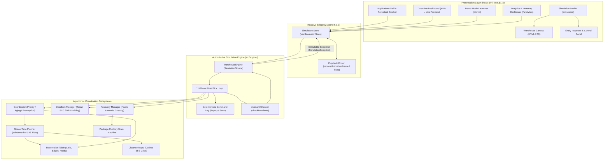
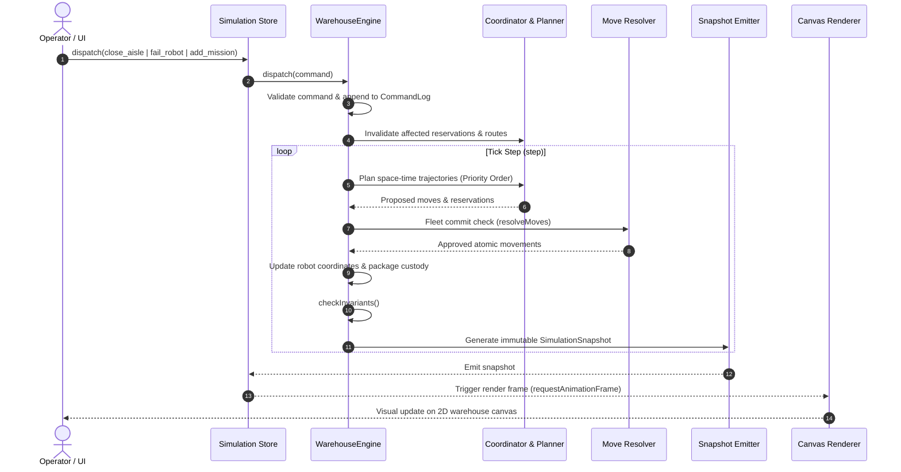
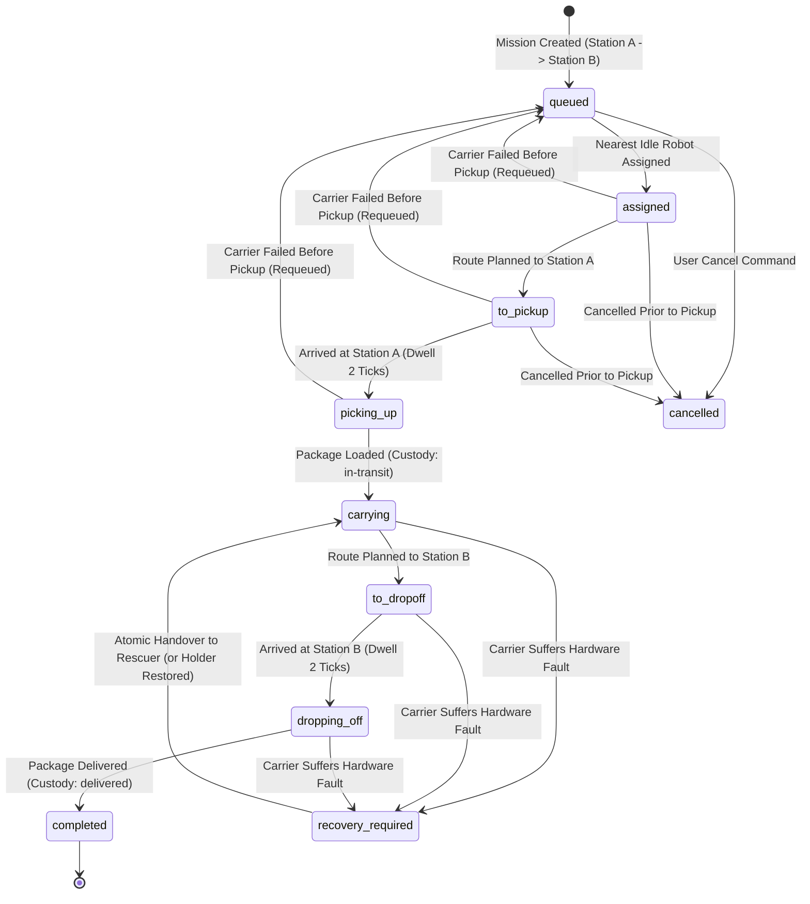

# SWARM — Complete System Architecture Specification

> **Status:** IMPLEMENTED (Source-Verified Architecture)  
> **Last Verified:** 2026-11-24  
> **Primary Authority:** `src/engine/warehouse-engine.ts`, `src/types/simulation.ts`, `src/lib/render/warehouse-renderer.ts`

---

## 1. High-Level Architecture Overview

SWARM is designed around a strict unidirectional data flow and clean separation of concerns. The simulation engine acts as the **authoritative single source of truth** for all warehouse state, robot trajectories, reservation tables, and custody lifecycles. Presentation components (React DOM and HTML5 Canvas) are strictly read-only consumers of immutable simulation snapshots.

### Diagram A: High-Level System Architecture



---

## 2. Frontend & Presentation Architecture

The presentation layer is implemented with Next.js 16 App Router and React 19:
- **Routes:** Seven core routes (`/`, `/simulation`, `/demo`, `/fleet`, `/missions`, `/incidents`, `/analytics`, `/settings`).
- **Unidirectional Dispatch:** User interactions (starting simulation, adding missions, closing aisles, injecting robot failures) dispatch typed `EngineCommand` objects to the store.
- **Decoupled Pacing:** `PlaybackDriver` (`src/components/layout/playback-driver.tsx`) manages wall-clock timing using `requestAnimationFrame`. The engine itself has zero awareness of browser timers, allowing instant headless execution and seeking.
- **Canvas Rendering Engine:** `warehouse-renderer.ts` is a pure function that paints directly to an HTML5 Canvas context based on `(snapshot, viewport, options)`. Canvas rendering never mutates engine state or computes robot paths.

---

## 3. Simulation Engine Architecture & Tick Execution Loop

The authoritative engine is `WarehouseEngine` (`src/engine/warehouse-engine.ts`), implementing the `SimulationSource` interface:

```ts
interface SimulationSource {
  readonly scenarioId: string;
  getSnapshot(): SimulationSnapshot;
  step(): SimulationSnapshot;
  reset(): SimulationSnapshot;
  seek(tick: number): SimulationSnapshot;
  dispatch(command: EngineCommand): CommandResult;
}
```

### The 11-Phase Fixed Tick Order
Every tick ($T \to T+1$) advances through 11 sequential, deterministic phases:
1. `tick += 1`: Increment discrete simulation clock.
2. **Scenario Commands:** Apply pre-scheduled scenario commands (e.g., automated fault injection).
3. **Seeded Mission Feed:** Conditionally queue new missions from seeded generator (skipping blocked stations).
4. **Failure Recovery Update:** `RecoveryManager.update()` evaluates stranded packages, timeouts, and rescuer dispatch *before* mission assignment, prioritizing cargo rescue.
5. **Mission Assignment:** Unassigned queued missions are assigned to the nearest idle, operational robot based on exact BFS distance heuristics.
6. **Preparation Phase:** Handle station dwell countdowns, custody handovers, restoration counters, and arrival confirmations.
7. **Coordination & Planning:** `Coordinator.plan()` calculates space-time routes for robots requiring replanning in descending priority order.
8. **Commit Phase:** `resolveMoves()` performs fleet-wide atomic movement verification, ensuring zero cell collisions or edge swaps.
9. **Apply Phase:** Advance robot positions, update carried package locations, increment waiting counters, and promote internal decisions to events.
10. **Deadlock Detection Phase:** Build wait-for graph with 6-cell route lookahead, run Tarjan's SCC, confirm 4-tick persistence, and issue yield orders.
11. **Invariant Assertion:** `checkInvariants()` verifies all spatial and custody invariants, throwing `InvariantViolation` if any rule is breached.

---

## 4. Simulation Data Flow

### Diagram B: Simulation Command-to-State Data Flow



---

## 5. Robot Mission Lifecycle

Missions transition through a strictly auditable state machine (`src/engine/missions/mission-lifecycle.ts`):

### Diagram C: Robot Mission Lifecycle State Machine



---

## 6. Robot Failure & Package Custody Handover Lifecycle

When a robot breaks down while carrying cargo, SWARM prevents inventory orphaning through an atomic handover protocol:

### Diagram D: Failure Recovery & Atomic Custody Lifecycle

```mermaid
sequenceDiagram
    autonumber
    participant RobotA as Failed Robot (R-01)
    participant Engine as WarehouseEngine
    participant RecMgr as Recovery Manager
    participant RobotB as Rescuer Robot (R-02)
    participant Custody as Package Custody System

    Note over RobotA: Carrying PKG-0004 to Dock S-03
    RobotA->>Engine: fail_robot(motor failure)
    Engine->>Engine: Halt R-01, release future reservations, hold cell
    Engine->>Custody: Transition PKG-0004 -> recovery-required
    Engine->>RecMgr: Open RecoveryTask (RC-01)
    
    RecMgr->>Engine: Query eligible idle robots (battery >= 15%)
    RecMgr->>RobotB: Dispatch R-02 to adjacent handover cell
    RobotB->>Engine: Reserve route via Space-Time Planner
    RobotB->>RobotB: Traverse grid to adjacent cell
    
    Note over RobotB,RobotA: R-02 arrives adjacent to R-01 (Dwell 2 ticks)
    RobotB->>Engine: Complete handover dwell
    Engine->>Custody: transferCustody(PKG-0004, R-01 -> R-02)
    Note over Custody: Atomic Handover: Holder becomes R-02
    Engine->>RobotB: Mission re-assigned; plan route to Dock S-03
    RobotB->>Engine: Deliver PKG-0004 to Dock S-03
    Note over Engine: Mission Completed; Custody: delivered
```

---

## 7. Dynamic Aisle Closure & Topology Invalidation

SWARM supports real-time layout modifications without restarting the engine:

### Diagram E: Dynamic Aisle Closure & Replanning Sequence

```mermaid
sequenceDiagram
    autonumber
    actor Operator as Operator
    participant Engine as WarehouseEngine
    participant ResTable as Reservation Table
    participant Coord as Coordinator
    participant Robot as Active Robot Fleet

    Operator->>Engine: dispatch(close_aisle, cells: [(6,4), (6,5)])
    Engine->>Engine: Register closure CL-01; mark cells impassable
    Engine->>ResTable: Identify all reservations intersecting closed cells
    ResTable-->>Engine: List of invalid robot reservations
    
    loop For Each Affected Robot
        Engine->>Robot: Emit route_invalidated(cell, closureId)
        Engine->>ResTable: Release future reservations from tick t+1 onwards
        Engine->>Coord: Flag robot for pendingReplan
    end

    Note over Engine: Robots standing inside closed cell retain current cell safely
    
    loop Next Simulation Tick
        Coord->>Coord: Replan affected robots around closure
        Coord-->>Engine: New reserved routes bypassing closed aisle
        Engine->>Robot: Emit robot_route_replanned(tick)
        Robot->>Robot: Resume movement along detour
    end
```

---

## 8. Integration Boundaries & Future Extensibility

SWARM’s modular design provides clear interfaces for future enterprise extensions:
- **SimulationSource Interface:** Future backend orchestrators (FastAPI / WebSockets) implement this exact interface, ensuring zero changes to presentation UI.
- **VDA 5050 Trajectory Boundary:** The `plan` array (`{ tick, x, y }`) directly maps to VDA 5050 `node` and `edge` trajectory objects with timestamps.
- **WMS Integration Boundary:** Package custody state transitions emit standardized JSON events (`package_custody_transferred`, `package-delivered`) compatible with enterprise message brokers (MQTT / Kafka).
